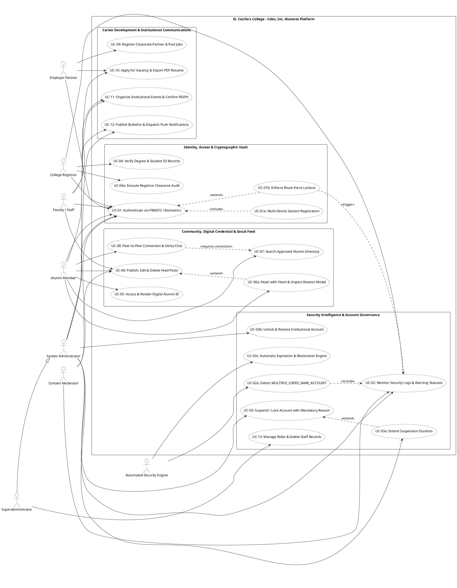

# Comprehensive Use Case Architecture & Formal Cockburn Narratives

> **System**: St. Cecilia's College - Cebu, Inc. Alumni Network (Alumnet)  
> **Classification**: Institutional Academic & Career Management Platform  
> **Document Type**: System Architecture Specification, Use Case Diagrams & Formal Use Case Narratives

---

## User Review & Critical Decisions

> [!IMPORTANT]
> The following parameters were confirmed during the clarification interview and govern this specification:
> 
> - **Diagram Formats**: Native PlantUML component/use case blocks and high-density ASCII box diagrams for cross-platform rendering and technical documentation exports.
> - **Coverage Scope**: Comprehensive multi-role analysis spanning Alumni, Employer Partners, Faculty/Staff, College Registrar, Content Moderators, System Administrators, Superadministrators, and Automated Security Background Engines.
> - **Narrative Standard**: Strict Alistair Cockburn Formal Template detailing primary/secondary actors, preconditions, triggers, main success scenarios (MSS), step-by-step extensions/alternative flows, postconditions, and non-functional guarantees.

---

## 1. Overview & Core Concept

**St. Cecilia's College - Cebu, Inc. Alumnet** is an enterprise-grade collegiate alumni portal bridging graduates, current students, institutional offices (Registrar, Alumni Affairs, Communications), faculty, and vetted corporate partners.

### Target Personas & Actor Hierarchy
1. **Unauthenticated Visitor / Candidate**: Browses public landing information, verified circulars, and initiates onboarding.
2. **Alumni Graduate (`alumni`)**: Holds a verified institutional degree, accesses the Digital Alumni ID, participates in peer networking, applies for job postings, generates verified PDF resumes, and interacts with institutional feeds.
3. **Employer Partner (`employer`)**: Undergoes accreditation review, posts employment opportunities, and reviews candidate applications.
4. **Faculty & Staff (`faculty` / `staff`)**: Publishes departmental circulars, organizes institutional events, and monitors student graduation outcomes.
5. **College Registrar (`registrar`)**: Maintains the official graduate registry, executes student clearance checks, cross-verifies degree credentials, and audits academic honors.
6. **Content Moderator (`moderator`)**: Reviews community contributions, moderates feed posts/comments, and inspects reported interactions.
7. **System Administrator (`admin`)**: Manages system users, executes temporary account suspensions with mandatory audit reasons, locks compromised accounts, inspects security logs, and configures portal governance.
8. **Superadministrator (`superadmin`)**: Exercises supreme governance, alters administrator roles, removes administrative records, and performs cold database exports.
9. **Automated Security Daemon (`System Engine`)**: Monitors concurrent multi-device logins, evaluates brute-force thresholds, executes suspension expirations, and dispatches Web Push notifications.

---

## 2. System Use Case Diagram (ASCII & PlantUML)

### 2.1 High-Level ASCII System Boundary Diagram

```
┌────────────────────────────────────────────────────────────────────────────────────────────────────────┐
│                        ST. CECILIA'S COLLEGE - CEBU, INC. ALUMNET SYSTEM BOUNDARY                      │
├────────────────────────────────────────────────────────────────────────────────────────────────────────┤
│                                                                                                        │
│  [ ACTORS ]                                     [ USE CASES ]                                          │
│                                                                                                        │
│  Alumni Graduate ────────┬───► (UC-01: Authenticate via PBKDF2 / WebAuthn Biometrics)                 │
│                          ├───► (UC-05: Generate & Present Signature Digital Alumni ID)                │
│                          ├───► (UC-06: Publish & Manage Milestone Updates on Campus Feed)             │
│                          ├───► (UC-07: Search Verified Alumni Directory & Connect)                    │
│                          ├───► (UC-08: Initiate Gated Peer-to-Peer Chat)                              │
│                          └───► (UC-10: Apply for Jobs & Export Certified PDF Resume)                  │
│                                                                                                        │
│  Employer Partner ───────┬───► (UC-09: Submit Corporate Accreditation & Post Vacancies)               │
│                          └───► (UC-10b: Review Applications & Download Resumes)                       │
│                                                                                                        │
│  College Registrar ──────┬───► (UC-04: Cross-Verify Student ID & Certify Academic Degree)             │
│                          └───► (UC-04b: Sync Masterlist & Validate Graduation Clearance)               │
│                                                                                                        │
│  Staff / Faculty ────────────► (UC-11: Create & Manage Reunions & Official Events)                    │
│                                                                                                        │
│  System Administrator ───┬───► (UC-02: Inspect Activity Logs & Detect Suspicious Sharing)             │
│                          ├───► (UC-03: Execute Account Suspension Scheduler & Reason Vault)           │
│                          ├───► (UC-03b: Unlock & Restore Suspended Accounts)                          │
│                          └───► (UC-12: Broadcast Emergency Circulars & Push Alerts)                  │
│                                                                                                        │
│  Superadministrator ─────┴───► (UC-13: Manage Administrative Roles & Superadmin Deletion Guard)       │
│                                                                                                        │
│  Security Engine ────────┬───► (UC-02b: Flag MULTIPLE_USERS_SAME_ACCOUNT & Repeated Failures)         │
│  (System Daemon)         └───► (UC-03c: Auto-Restore Expired Suspended Accounts)                      │
│                                                                                                        │
└────────────────────────────────────────────────────────────────────────────────────────────────────────┘
```

### 2.2 Comprehensive PlantUML Specification



---

## 3. Formal Cockburn Use Case Narratives

---

### Use Case UC-01: Multi-Factor & Biometric User Authentication
* **Use Case ID**: UC-01
* **Use Case Name**: Authenticate User Session (Password Vault & WebAuthn Biometrics)
* **Primary Actor**: Registered User (Alumni, Employer, Registrar, Faculty, Staff, Admin, Superadmin)
* **Secondary Actors**: WebAuthn Authenticator (Platform TPM / Touch ID / Windows Hello), PBKDF2 Vault Service, Audit Log Engine.
* **Scope**: Alumnet Authentication Subsystem
* **Level**: User-Goal Level
* **Preconditions**:
  1. The user has an existing account in the Firestore or local cryptographic vault.
  2. The account status is `ACTIVE` (not `SUSPENDED` or `LOCKED`).
* **Trigger**: The user navigates to the login screen and submits credentials or clicks "Sign in with Biometrics".
* **Main Success Scenario (MSS)**:
  1. User enters their institutional email/username and password.
  2. System derives the PBKDF2 hash using the stored salt over 100,000 iterations (SHA-256).
  3. System matches derived key against vault storage.
  4. System verifies that the account status is `ACTIVE`.
  5. System records an audit entry with `action: 'USER_LOGIN'`, `classification: 'NORMAL'`, and `showWarningIcon: false`.
  6. System registers the current device fingerprint and active session timestamp.
  7. System grants a secure session token and redirects the user to their role-specific dashboard.
* **Extensions / Alternative Flows**:
  * **3a. Password mismatch (Single attempt)**:
    1. System logs `FAILED_LOGIN_ATTEMPT`, flags status as `WARNING`, and sets `showWarningIcon: true` (⚠️).
    2. System increments failed login counter for the username.
    3. Password text is sanitized and never stored in activity logs.
    4. System displays "Invalid credentials" error to user.
  * **3b. Password mismatch exceeds threshold (3 consecutive failures)**:
    1. System records `MULTIPLE_FAILED_LOGIN_ATTEMPTS` with status `SUSPICIOUS` and `showWarningIcon: true` (⚠️).
    2. System alerts the administrative security queue.
  * **3c. Account lockout threshold reached (5 consecutive failures)**:
    1. System updates user status to `LOCKED`.
    2. System records `ACCOUNT_LOCKED` with status `LOCKED`, `showWarningIcon: true` (⚠️), and details of lockout reason.
    3. System notifies the administrator and rejects future login attempts until administratively restored.
  * **4a. Account is currently SUSPENDED**:
    1. System detects `accountStatus === 'SUSPENDED'`.
    2. System checks `suspensionEndDate`. If end date is in the future, system blocks login and displays the suspension start date, end date, and administrative reason.
  * **1b. User elects WebAuthn Biometric Login**:
    1. System retrieves public key credential challenge via `navigator.credentials.get()`.
    2. User touches biometric sensor (Fingerprint / Face ID).
    3. Browser validates authenticator assertion; system admits user without manual password entry.
* **Postconditions**:
  * User is authenticated with valid JWT/session token.
  * Successful login is logged as `USER_LOGIN` (`NORMAL`, no warning icon).
* **Special Requirements**: Mobile viewports automatically disable employer registration tabs while preserving biometric login shortcuts.

---

### Use Case UC-02: Security Audit Logging & Real-Time Suspicious Account Sharing Detection
* **Use Case ID**: UC-02
* **Use Case Name**: Evaluate Concurrent Sessions & Detect MULTIPLE_USERS_SAME_ACCOUNT
* **Primary Actor**: Automated Security Engine
* **Secondary Actors**: System Administrator, Registrar.
* **Scope**: Security & Threat Intelligence Engine
* **Level**: Sub-function / Institutional Guardrail
* **Preconditions**:
  1. An account has active sessions or incoming requests from distinct network/hardware identifiers.
* **Trigger**: A new session connects while another active session exists, or conflicting operational telemetry is received.
* **Main Success Scenario (MSS)**:
  1. Security daemon intercepts incoming session telemetry (browser signature, device platform, operating system, and geolocation timing).
  2. System compares incoming session with known active session timestamps.
  3. Evidence verification applies rule: Different devices or IP addresses alone do **not** trigger a suspicious event (legitimate mobile + desktop usage).
  4. If impossible geographic velocity, conflicting concurrent interactions, or disparate credentials occur within an active window:
     * System records audit log `MULTIPLE_USERS_SAME_ACCOUNT`.
     * System classifies event status as `SUSPICIOUS`.
     * System sets `showWarningIcon: true` (⚠️).
     * System includes concurrent session metrics in log metadata.
  5. System triggers real-time security alert toast to all active System Administrators.
* **Extensions / Alternative Flows**:
  * **4a. Administrator inspects suspicious activity**:
    1. Administrator opens Security & Audit Logs view.
    2. Table highlights event in amber/yellow with `⚠️ SUSPICIOUS` badge.
    3. Admin clicks entry to inspect inspector drawer with concurrent IP, device hash, and timestamps.
    4. Admin can directly initiate temporary suspension or account lock from the inspector panel.
* **Postconditions**:
  * Event stored with complete audit payload; passwords remain strictly masked.
  * Admin dashboard badge count increments.

---

### Use Case UC-03: Administrative Account Suspension Scheduler & Reason Management
* **Use Case ID**: UC-03
* **Use Case Name**: Suspend or Lock User Account with Scheduled Duration and Mandatory Justification
* **Primary Actor**: System Administrator (`admin` or `superadmin`)
* **Secondary Actors**: Target User, Database Engine, Audit Logger.
* **Scope**: Administrative Governance Subsystem
* **Level**: User-Goal Level
* **Preconditions**:
  1. Actor possesses `canAccessAdminPanel` permissions.
  2. Target account belongs to any registered role (`alumni`, `registrar`, `faculty`, `staff`, `employer`).
* **Trigger**: Administrator clicks "Suspend" or "Lock" on a user record in the administrative directory or audit log drawer.
* **Main Success Scenario (MSS)**:
  1. System opens the **Account Suspension & Lock Scheduler Modal**.
  2. Modal displays the target user's full name, username, assigned role, and current status.
  3. Administrator selects suspension duration:
     * Quick presets: `1 hour`, `24 hours`, `3 days`, `7 days`, `15 days`, `30 days`.
     * Or selects `Custom date and time`.
  4. System automatically computes and formats the `suspensionStartDate` and `suspensionEndDate`.
  5. Administrator chooses or types the mandatory **Reason for Account Suspension** (e.g., "Suspicious account sharing", "Multiple people detected using one account", "Repeated incorrect login attempts", or custom text).
  6. Administrator clicks "Confirm Suspension".
  7. System validates that the reason field is non-empty.
  8. System updates the target user's `accountStatus` to `SUSPENDED`, persisting `suspensionStartDate`, `suspensionEndDate`, and `suspensionReason`.
  9. System terminates active user sessions.
  10. System generates an audit log entry:
      * `action: 'ACCOUNT_SUSPENDED'`
      * `status: 'SUSPENDED'`
      * `showWarningIcon: true` (⚠️)
      * `details`: User, duration, and exact reason.
  11. Success toast is displayed to the administrator.
* **Extensions / Alternative Flows**:
  * **5a. Admin leaves suspension reason blank**:
    1. Form submission is blocked with validation error: "Suspension explanation is required."
  * **3b. Admin chooses Permanent Lock instead of Temporary Suspension**:
    1. Status set to `LOCKED`.
    2. End date is marked indefinite (`null`).
    3. Audit log records `ACCOUNT_LOCKED` (`LOCKED`, ⚠️ Yes).
  * **6a. Admin extends an active suspension**:
    1. Admin clicks "Extend Suspension".
    2. Admin selects new expiration date/time and enters extension reason.
    3. Audit log records `ACCOUNT_SUSPENSION_EXTENDED` (`WARNING`, ⚠️ Yes).
  * **6b. Admin restores account access before expiration**:
    1. Admin clicks "Unlock Account" and inputs an administrative restoration note.
    2. Status switches to `ACTIVE`.
    3. Audit log records `ADMIN_UNLOCKED_ACCOUNT` with status `NORMAL` and `showWarningIcon: false`.
  * **8a. Automated background expiration occurs**:
    1. Security Engine detects `currentTime >= suspensionEndDate` for a `SUSPENDED` user.
    2. System restores `accountStatus` to `ACTIVE`.
    3. System logs `ACCOUNT_AUTO_RESTORED` (`NORMAL`, `showWarningIcon: false`).
* **Postconditions**:
  * User is barred from signing in until `suspensionEndDate` expires or Admin unlocks.
  * Historical suspension reason is preserved in user profile metadata and audit tables.

---

### Use Case UC-04: Registrar Clearance & Academic Degree Verification
* **Use Case ID**: UC-04
* **Use Case Name**: Verify Student ID against Registrar Masterlist and Certify Alumni Standing
* **Primary Actor**: College Registrar (`registrar`)
* **Secondary Actors**: Alumni Applicant, Student Verification Service.
* **Scope**: Academic Registry & Accreditation Module
* **Level**: User-Goal Level
* **Preconditions**:
  1. An alumni user registered with a Student ID number (format `YYYY-NNNNN`) or requested self-verification.
* **Trigger**: Registrar opens the Registrar Registry view or clicks "Verify Clearance" in the user management table.
* **Main Success Scenario (MSS)**:
  1. Registrar searches for graduate by Student ID, full name, or graduation batch.
  2. System compares portal registration against the verified institutional masterlist.
  3. System renders the degree program (e.g., BS Information Technology, BS Nursing, BS Criminology), year graduated, and Latin honors.
  4. Registrar reviews clearance status (financial, library, and department clearance).
  5. Registrar clicks "Approve & Certify Graduate".
  6. System transitions user state from `PENDING_VERIFICATION` to `ACTIVE` and sets `isVerified: true`.
  7. System issues a unique cryptographic Alumni Card Serial ID.
  8. System records `REGISTRAR_VERIFIED_STUDENT` in audit logs (`NORMAL`, no warning icon).
  9. Alumni receives confirmation notification and unlocked access to the verified directory.
* **Extensions / Alternative Flows**:
  * **2a. Student ID not found in masterlist**:
    1. Registrar flags record with "Discrepancy Note".
    2. System sends clarification prompt to graduate requesting scanned Diploma or Transcript of Records.
* **Postconditions**:
  * Alumni account gains verified badge (`ShieldCheck`).
  * Account appears in the public alumni directory.

---

### Use Case UC-05: Access & Render Signature Digital Alumni ID
* **Use Case ID**: UC-05
* **Use Case Name**: Generate, Flip, and Present Digital Alumni Identification Card
* **Primary Actor**: Verified Alumni
* **Secondary Actors**: Campus Security Turnstile Scanner, QR Code Generator Service.
* **Scope**: Digital Credential Subsystem
* **Level**: User-Goal Level
* **Preconditions**:
  1. User is logged in as an approved alumni member.
* **Trigger**: Alumni navigates to "Profile" and views "Digital Alumni Card".
* **Main Success Scenario (MSS)**:
  1. System checks user accreditation status.
  2. System dynamically renders the front of the Digital ID:
     * College Seal with transparent background (`/assets/st-cecilias-seal-transparent.svg`).
     * Signature deep crimson gradient (`#8B181B` via `#6b1215` to `#2b0709`) with gold border trim.
     * Profile picture, graduate full name, degree title, student ID, and graduation batch year.
     * Verified Graduate gold emblem.
  3. Alumni clicks the card or the "Flip ID" toggle button.
  4. Card executes a 3D perspective flip (`rotateY(180deg)`) displaying the reverse side:
     * High-density QR Code encoding institutional verification URL.
     * Card validity status and Campus Security access clearance.
     * College contact info and Lasallian motto.
  5. Alumni presents ID at campus gates or downloads card image.
* **Extensions / Alternative Flows**:
  * **1a. User account is unverified or suspended**:
    1. System replaces QR code with "Verification Required" or "Access Suspended" overlay.
* **Postconditions**:
  * Verified digital credential rendered in compliance with institutional branding guidelines.

---

### Use Case UC-06: Interactive Campus Feed & Milestone Contributions
* **Use Case ID**: UC-06
* **Use Case Name**: Publish, Edit, React, and Delete Campus Feed Contributions
* **Primary Actor**: Alumni, Faculty, or Administrator
* **Secondary Actors**: Alumni Network Followers, Feed Notification Engine.
* **Scope**: Community Social Feed Module
* **Level**: User-Goal Level
* **Preconditions**:
  1. User is authenticated and account is active.
* **Trigger**: User creates an achievement milestone or navigates to the Campus Feed.
* **Main Success Scenario (MSS)**:
  1. User inputs post title, category (Milestone, Campus Gallery, or Bulletin), and text description.
  2. User optionally attaches a validated photo or campus landmark image.
  3. User clicks "Publish to Alumni Feed".
  4. System validates inputs, attaches user identity, and persists post to Firestore.
  5. Post appears in the real-time social feed and is automatically synced to the author's own profile page under "My Feed Posts & Updates".
  6. Other Cecilians view the post and react by clicking the **Heart** icon.
  7. System increments heart count and stores reactor user ID.
  8. Any user can click the heart badge to open the **Reactor Modal**, viewing the list of alumni who gave hearts.
* **Extensions / Alternative Flows**:
  * **6a. Author attempts to react to their own achievement post**:
    1. System blocks self-congratulations per policy.
    2. System triggers a toast: "You cannot heart your own post."
  * **3b. Post author wishes to edit content**:
    1. Author clicks "Edit Post" (Pencil icon) available on the feed card or on their profile tab.
    2. System opens the Edit Post Modal with prefilled title and description.
    3. Author updates text and clicks "Save Changes".
    4. Post content updates in real-time across both the main feed and profile view.
  * **3c. Post author or Admin wishes to delete post**:
    1. User clicks the Delete icon (Trash2).
    2. System displays a destructive Confirmation Modal.
    3. User confirms deletion. System permanently removes post and updates feed without page reload.
* **Postconditions**:
  * Social feed reflects accurate contributions; heart interactions and author modifications persist.

---

### Use Case UC-07: Search Approved Alumni Directory & Establish Connections
* **Use Case ID**: UC-07
* **Use Case Name**: Query Verified Directory and Request Mutual Peer Connection
* **Primary Actor**: Verified Alumni
* **Secondary Actors**: Target Alumni, Directory Privacy Filter.
* **Scope**: Directory & Networking Subsystem
* **Level**: User-Goal Level
* **Preconditions**:
  1. Current user is logged in with verified alumni standing.
* **Trigger**: User opens the "Directory / Network" tab.
* **Main Success Scenario (MSS)**:
  1. System queries the directory, applying strict privacy and governance filters:
     * Accounts with `PENDING`, `IN_REVIEW`, `SUSPENDED`, or `LOCKED` are completely excluded.
     * Accounts holding `admin`, `superadmin`, or `moderator` roles are excluded from the public alumni network view.
  2. System renders verified alumni cards with program, graduation batch, current employer, and city.
  3. Current user applies keyword search, batch filter, or degree program filter.
  4. Current user clicks "Connect" on a peer's card.
  5. System records a connection request in the database and dispatches a notification to the recipient.
  6. Recipient accepts the request; both users become mutually marked as `isConnected: true`.
* **Extensions / Alternative Flows**:
  * **1a. Unverified user attempts to view directory**:
    1. System displays an access gate informing user that registrar degree clearance is required.
* **Postconditions**:
  * Mutual connection record is established, unlocking direct messaging between both members.

---

### Use Case UC-08: Peer-to-Peer Encrypted Direct Messaging
* **Use Case ID**: UC-08
* **Use Case Name**: Send Direct Messages to Connected Alumni
* **Primary Actor**: Verified Alumni
* **Secondary Actors**: Recipient Alumni, Push Notification Service.
* **Scope**: Communications Subsystem
* **Level**: User-Goal Level
* **Preconditions**:
  1. Both users are active accounts.
  2. Users have a mutual connection (`isConnected === true`).
* **Trigger**: Alumni clicks "Message" on a connected peer's profile or selects them in the Messages tab.
* **Main Success Scenario (MSS)**:
  1. System opens the conversation view with a sticky header displaying the peer's avatar, name, and degree.
  2. System loads the encrypted message thread in chronological order.
  3. Sender types a message and clicks Send.
  4. System verifies mutual connection status.
  5. System appends message, updates conversation snippet, and dispatches a Web Push alert to the recipient.
* **Extensions / Alternative Flows**:
  * **4a. Users are not mutually connected**:
    1. System hides the text composer and displays a connection gate card: "Direct messaging is reserved for connected Cecilians."
    2. An action button allows sending a connection request directly from the chat pane.
* **Postconditions**:
  * Chat history is updated in real-time with responsive sticky positioning.

---

### Use Case UC-09: Corporate Employer Accreditation & Job Opportunities
* **Use Case ID**: UC-09
* **Use Case Name**: Vetting Employer Partner and Publishing Career Vacancy
* **Primary Actor**: Employer Partner (`employer`)
* **Secondary Actors**: Career Office Administrator, Alumni Applicants.
* **Scope**: Career Placement Subsystem
* **Level**: User-Goal Level
* **Preconditions**:
  1. Employer accesses the portal on desktop (employer registration CTA is disabled on mobile viewports).
* **Trigger**: Corporate representative registers company and requests accreditation.
* **Main Success Scenario (MSS)**:
  1. Representative enters company profile, business registration number, industry, and contact person.
  2. Career Office Admin reviews accreditation documents and clicks "Approve Partner".
  3. Employer receives approved partner status and accesses the Job Posting Studio.
  4. Employer inputs job title, employment type (Full-time, Part-time, Internship), salary range, and qualification requirements.
  5. Employer publishes the listing.
  6. Opportunity appears in the Alumni Jobs Board with verified partner badge.
* **Postconditions**:
  * Listing is indexed in the career portal and available for alumni applications.

---

### Use Case UC-10: Alumni Job Application & Automated Resume Generation
* **Use Case ID**: UC-10
* **Use Case Name**: Submit Career Application and Generate Official Institutional PDF Resume
* **Primary Actor**: Alumni Jobseeker
* **Secondary Actors**: Hiring Employer, PDF Resume Service (`jsPDF` / canvas engine).
* **Scope**: Career Placement & Student Services
* **Level**: User-Goal Level
* **Preconditions**:
  1. Alumni has an active account with completed profile experience and education.
* **Trigger**: Alumni clicks "Apply" on an active vacancy or clicks "Export Official Resume" on their profile.
* **Main Success Scenario (MSS)**:
  1. Alumni reviews job qualifications.
  2. Alumni clicks "Generate Certified PDF Resume".
  3. System compiles verified degree from registrar records, career experience, and contact data into a clean, two-column collegiate resume template bearing the St. Cecilia's crest.
  4. System renders an in-app PDF preview modal.
  5. Alumni confirms and submits the application package to the employer partner.
  6. Employer receives candidate dossier with verified alumni credential watermark.
* **Postconditions**:
  * Application logged in employer dashboard; applicant receives confirmation email and notification.

---

### Use Case UC-11: Institutional Events, Reunions & Confirmed Attendance
* **Use Case ID**: UC-11
* **Use Case Name**: Create Campus Homecoming Event and Manage Confirmed RSVPs
* **Primary Actor**: Alumni Relations Staff / Administrator
* **Secondary Actors**: Alumni Attendees.
* **Scope**: Events & Alumni Relations Subsystem
* **Level**: User-Goal Level
* **Preconditions**:
  1. Actor has event publication privileges.
* **Trigger**: Staff member schedules a new alumni homecoming, webinar, or reunion.
* **Main Success Scenario (MSS)**:
  1. Staff inputs event title, date, start time, venue/virtual link, and registration cap.
  2. Staff publishes event to the calendar.
  3. Alumni browse upcoming events and click "RSVP: Going".
  4. System registers user as confirmed guest (`status: 'going'`).
  5. Event dashboard attendees list displays strictly confirmed participants (unbacked featured badges and speculative attendees are omitted).
  6. System dispatches a calendar invite and 24-hour reminder email to confirmed attendees.
* **Postconditions**:
  * Event attendee roster accurately reflects confirmed Cecilians.

---

### Use Case UC-12: Campus News, Bulletins & Web Push Broadcasts
* **Use Case ID**: UC-12
* **Use Case Name**: Publish Official Circular with High Dark-Mode Contrast & Dispatch Push Alerts
* **Primary Actor**: College Communications Office / Administrator
* **Secondary Actors**: Alumni Subscribers, Push Notification Service Worker.
* **Scope**: Public Communications Subsystem
* **Level**: User-Goal Level
* **Preconditions**:
  1. Communications officer has announcement publishing role.
* **Trigger**: Officer publishes an urgent or general circular.
* **Main Success Scenario (MSS)**:
  1. Officer drafts bulletin with category (Academic Affairs, Career, Emergency, General) and optional photo banner.
  2. Officer flags announcement as "Urgent" or "Pinned" if critical.
  3. System renders announcement with enhanced dark-mode surface contrast (`dark:bg-stone-900`, `dark:text-stone-100`).
  4. System dispatches VAPID Web Push notification to subscribed devices.
  5. Cecilians receive notification and click to open the full rich-text advisory modal.
* **Postconditions**:
  * Circular is archived in portal history; push notification metrics recorded.

---

### Use Case UC-13: Superadministrator Role Management & Staff Protection Guardrail
* **Use Case ID**: UC-13
* **Use Case Name**: Superadmin Governance and Administrator Deletion Protection
* **Primary Actor**: Superadministrator (`superadmin`)
* **Secondary Actors**: Target Administrator, User Management Service.
* **Scope**: Enterprise Identity & Access Governance
* **Level**: Strategic Governance Level
* **Preconditions**:
  1. Authenticated user possesses role `superadmin`.
* **Trigger**: Superadmin accesses the Administrative Users Table to modify staff privileges or prune stale records.
* **Main Success Scenario (MSS)**:
  1. Superadmin views the list of institutional users.
  2. For staff members, Superadmin adjusts roles between `moderator`, `staff`, `registrar`, `admin`, and `superadmin` (alumni and employer roles remain fixed to preserve registration fidelity).
  3. If an administrative record (`admin`) must be removed, the delete button is rendered exclusively to the Superadmin.
  4. Standard administrators do **not** have delete buttons visible on peer admin accounts.
  5. Superadmin confirms deletion in the danger modal; record and associated credentials are permanently purged.
* **Extensions / Alternative Flows**:
  * **3a. Standard Admin attempts to invoke delete on another Admin**:
    1. UI suppresses the delete button.
    2. Server-side validation rejects any direct API call: "Only Superadmin accounts can delete institutional administrators."
* **Postconditions**:
  * Strict separation of powers maintained across collegiate administrative tiers.

---

## 4. Implementation & Data Strategy

```
┌────────────────────────────────────────────────────────────────────────────────────────┐
│                        DATA PERSISTENCE & RUNTIME ENGINE MAPPING                       │
├────────────────────────────────────────────────────────────────────────────────────────┤
│                                                                                        │
│  [ FRONTEND VIEW CONTROLLERS ]                                                         │
│  • AuthPage / AuthModal         ──► UC-01 (PBKDF2 & WebAuthn biometrics)               │
│  • AuditLogView                 ──► UC-02 (Activity logs, warnings, ⚠️ icons)          │
│  • AdminUsersTable              ──► UC-03 & UC-13 (Suspension scheduler, superadmin)   │
│  • DigitalAlumniCard            ──► UC-05 (Crimson gradient, transparent seal, QR)     │
│  • InstitutionalSocialFeed      ──► UC-06 (Heart reactions, author edit/delete, sync)  │
│  • NetworkView                  ──► UC-07 (Directory filters, unverified exclusion)    │
│  • MessagesView                 ──► UC-08 (Sticky header, mutual connection gating)    │
│  • AnnouncementsView            ──► UC-12 (Bulletins, dark mode contrast, VAPID push)  │
│                                                                                        │
│  [ BACKEND / SERVICES LAYER ]                                                          │
│  • server.ts (/api/admin/*)     ──► Role-scoped query filtering & suspension engine    │
│  • studentVerificationService   ──► Registrar masterlist verification (UC-04)          │
│  • pdfResumeService             ──► Client-side certified resume export (UC-10)        │
│  • pushNotificationService      ──► Web Push VAPID alerts delivery                     │
│                                                                                        │
│  [ DATA STORES ]                                                                       │
│  • Google Cloud Firestore       ──► Persistent document storage (users, logs, posts)   │
│  • Web Crypto Local Vault       ──► Client cryptographic key derivation (100k iters)   │
│                                                                                        │
└────────────────────────────────────────────────────────────────────────────────────────┘
```
