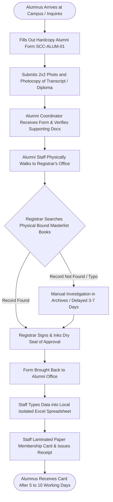
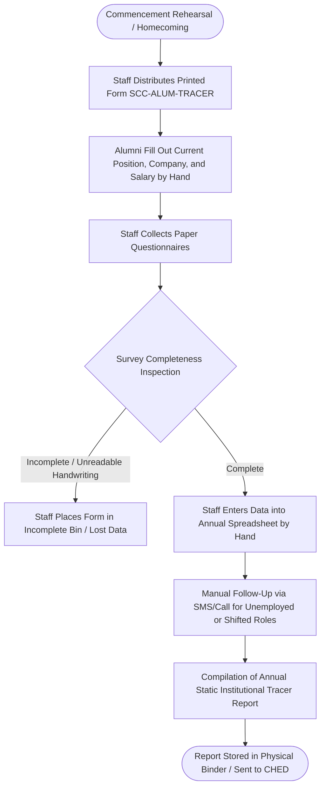
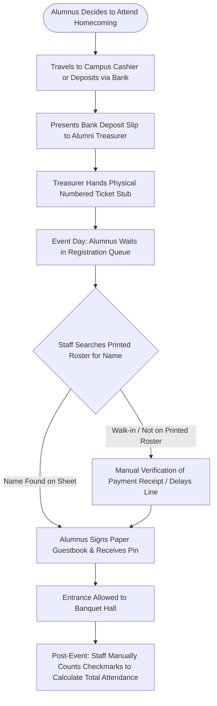
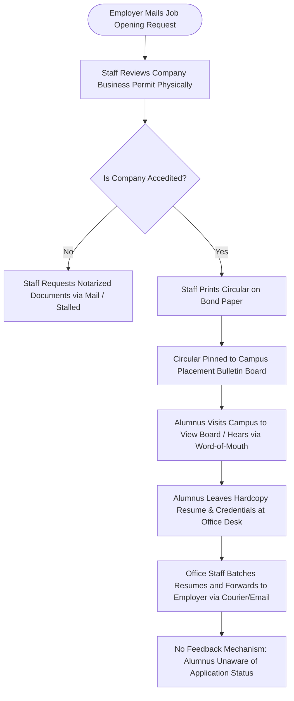
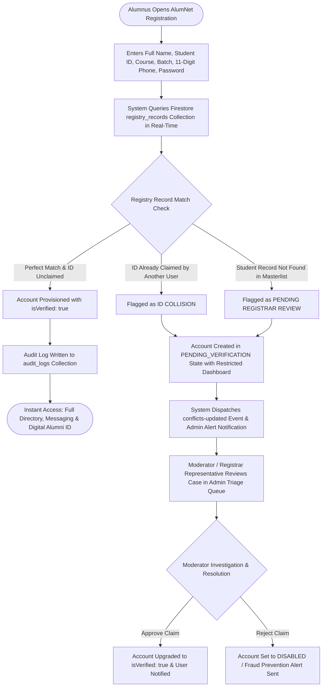
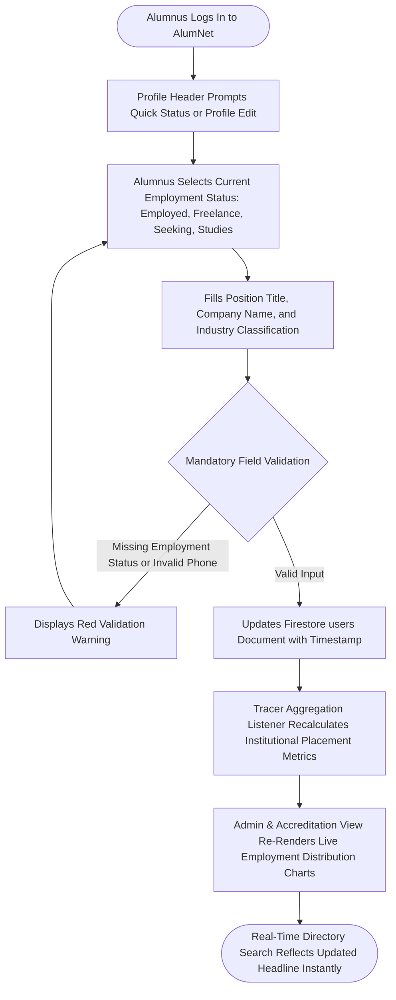
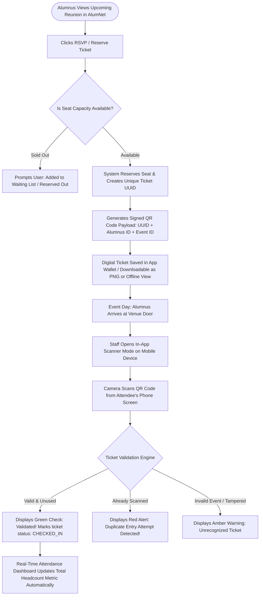
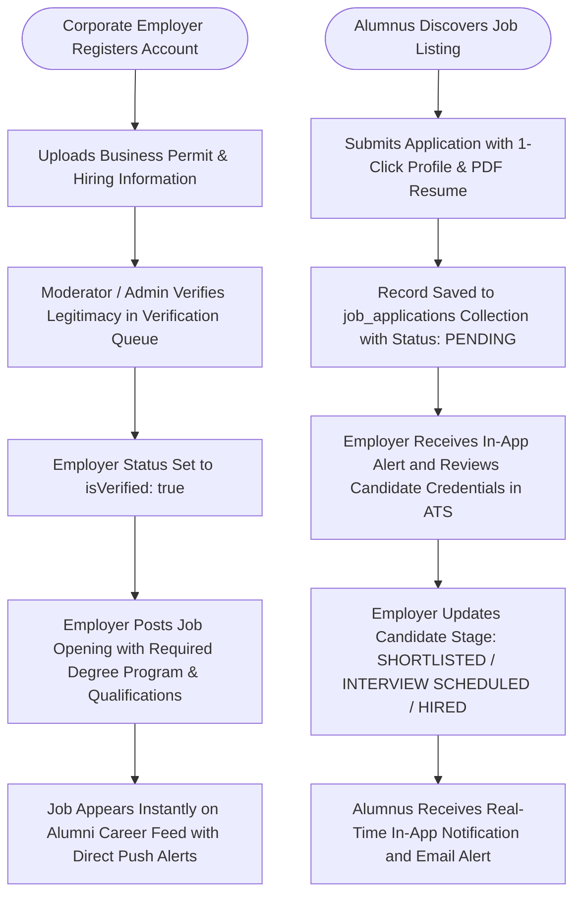

# System Flow Diagrams

**Institution:** St. Cecilia's College - Cebu, Inc.  
**System Title:** AlumNet: A Web and Mobile-Based Alumni Networking and Tracer System  
**Document Section:** Chapter / Section E — System Flow Diagrams & Institutional Reports  

---

## Table of Contents
1. [E.1 – Current / Manual Flow of the System](#e1--current--manual-flow-of-the-system)
   - [Overview of the Legacy Operational Environment](#overview-of-the-legacy-operational-environment)
   - [Subsystem 1: Manual Alumni Registration & Identity Verification](#subsystem-1-manual-alumni-registration--identity-verification)
   - [Subsystem 2: Manual Alumni Tracer & Employment Record Updating](#subsystem-2-manual-alumni-tracer--employment-record-updating)
   - [Subsystem 3: Manual Reunion & Event Ticket Distribution / Attendance](#subsystem-3-manual-reunion--event-ticket-distribution--attendance)
   - [Subsystem 4: Manual Career Opportunity Posting & Resume Routing](#subsystem-4-manual-career-opportunity-posting--resume-routing)
   - [Operational Bottlenecks & Failure Modes](#operational-bottlenecks--failure-modes)
2. [E.2 – Sample Reports (Current System)](#e2--sample-reports-current-system)
   - [Sample Report E.2.1: Manual Registrar Graduation Masterlist (Form SCC-REG-ML-2023)](#sample-report-e21-manual-registrar-graduation-masterlist-form-scc-reg-ml-2023)
   - [Sample Report E.2.2: Paper-Based Alumni Tracer Survey Form (Form SCC-ALUM-TRACER-01)](#sample-report-e22-paper-based-alumni-tracer-survey-form-form-scc-alum-tracer-01)
   - [Sample Report E.2.3: Homecoming Banquet Physical Attendance Logbook (Form SCC-EVT-LOG-2024)](#sample-report-e23-homecoming-banquet-physical-attendance-logbook-form-scc-evt-log-2024)
   - [Sample Report E.2.4: Campus Bulletin Board Job Posting & Resume Routing Slip (Form SCC-CAREER-POST)](#sample-report-e24-campus-bulletin-board-job-posting--resume-routing-slip-form-scc-career-post)
3. [E.3 – Proposed Flow of the System](#e3--proposed-flow-of-the-system)
   - [Overview of the Automated AlumNet Platform](#overview-of-the-automated-alumnet-platform)
   - [Subsystem 1: Algorithmic Registrar Cross-Matching & Instant Claiming Flow](#subsystem-1-algorithmic-registrar-cross-matching--instant-claiming-flow)
   - [Subsystem 2: Continuous Real-Time Alumni Tracer & Profile Synchronization](#subsystem-2-continuous-real-time-alumni-tracer--profile-synchronization)
   - [Subsystem 3: Digital Event RSVP, Dynamic QR Ticket Generation & Contactless Check-In](#subsystem-3-digital-event-rsvp-dynamic-qr-ticket-generation--contactless-check-in)
   - [Subsystem 4: Accredited Corporate Job Board & In-App Applicant Tracking System (ATS)](#subsystem-4-accredited-corporate-job-board--in-app-applicant-tracking-system-ats)
   - [Performance & Latency Comparison: Manual vs. Automated](#performance--latency-comparison-manual-vs-automated)
4. [E.4 – Sample Reports (Proposed System)](#e4--sample-reports-proposed-system)
   - [Sample Report E.4.1: Automated Graduate Tracer & Employment Analytics Summary](#sample-report-e41-automated-graduate-tracer--employment-analytics-summary)
   - [Sample Report E.4.2: Real-Time Event Attendance & Digital QR Ticket Scanning Reconciliation Audit](#sample-report-e42-real-time-event-attendance--digital-qr-ticket-scanning-reconciliation-audit)
   - [Sample Report E.4.3: Corporate Partnership & Career Placement Pipeline Summary](#sample-report-e43-corporate-partnership--career-placement-pipeline-summary)
   - [Sample Report E.4.4: Alumni Identity Verification & Conflict Resolution Audit Log](#sample-report-e44-alumni-identity-verification--conflict-resolution-audit-log)

---

## E.1 – Current / Manual Flow of the System

### Overview of the Legacy Operational Environment
Prior to the implementation of **AlumNet**, the alumni management, graduate tracing, event management, and career placement services of **St. Cecilia's College - Cebu, Inc.** operated through fragmented, paper-intensive, and manual routines. Interactions between the Alumni Relations Office, the College Registrar, graduating cohorts, alumni, and prospective employers depended on physical visits to the campus, printed logbooks, telephone calls, disparate social media chat groups, and physical bulletin boards.

Below are the detailed operational workflows for the four primary manual subsystems.

---

### Subsystem 1: Manual Alumni Registration & Identity Verification

In the manual system, an alumnus wishing to register with the institutional alumni association or request official alumni certification had to visit the campus or coordinate via unstructured email exchanges.

#### Box-Drawing Workflow: Manual Alumni Verification
```
┌──────────────┐     1. Physical Appearance     ┌───────────────────────┐
│              ├───────────────────────────────►│  Alumni Relations     │
│  Graduating  │                                │  Office Coordinator   │
│   Alumnus    │◄───────────────────────────────┤  (Admin Assistant)    │
│              │     4. Paper Membership Card   └───────────┬───────────┘
└──────────────┘                                            │
                                            2. Physical Logbook &
                                               Record Slip Forwarding
                                                            ▼
                                                ┌───────────────────────┐
                                                │  Office of the        │
                                                │  College Registrar    │
                                                └───────────┬───────────┘
                                                            │
                                            3. Physical Ledger Search
                                               & Manual Stamp Approval
                                                            ▼
                                                ┌───────────────────────┐
                                                │  Permanent Record     │
                                                │  Filing Cabinets      │
                                                │  (Hardcopy Ledgers)   │
                                                └───────────────────────┘
```

#### Mermaid Flowchart: Manual Alumni Verification


---

### Subsystem 2: Manual Alumni Tracer & Employment Record Updating

Tracking the professional outcomes of Cecilian graduates for institutional accreditation and CHED reporting was performed via mimeographed survey forms handed out during graduation rehearsals or annual homecoming banquets, supplemented by unlinked Google Forms distributed across social media.

#### Box-Drawing Workflow: Manual Tracer Process
```
┌──────────────┐   1. Distribute Paper Questionnaire   ┌───────────────────────┐
│  Graduating  ├──────────────────────────────────────►│  Placement & Guidance │
│   Alumni     │                                       │  Office Staff         │
│   Cohort     │◄──────────────────────────────────────┤                       │
└──────────────┘   3. Follow-up Telephone Inquiries    └───────────┬───────────┘
                                                                   │
                                                    2. Manually Collate,
                                                       Sort & Transcribe
                                                                   ▼
                                                       ┌───────────────────────┐
                                                       │  Unindexed Hardcopy   │
                                                       │  Tracer Binders       │
                                                       │  (Filing Vault)       │
                                                       └───────────┬───────────┘
                                                                   │
                                                    4. Manual Statistical
                                                       Headcount & Tally
                                                                   ▼
                                                       ┌───────────────────────┐
                                                       │  Static Annual Tracer │
                                                       │  Report (Word/Excel)  │
                                                       └───────────────────────┘
```

#### Mermaid Flowchart: Manual Tracer Process


---

### Subsystem 3: Manual Reunion & Event Ticket Distribution / Attendance

Institution-wide reunions, Grand Alumni Homecomings, and college webinars required printed paper tickets with serial numbers, in-person cash payments, and manual pen-and-paper guest sign-in rosters at the entrance.

#### Box-Drawing Workflow: Manual Event Ticketing & Attendance
```
┌──────────────┐   1. In-Person Payment / Reservation   ┌───────────────────────┐
│  Attending   ├───────────────────────────────────────►│  Alumni Association   │
│   Alumnus    │                                        │  Treasurer / Staff    │
│              │◄───────────────────────────────────────┤                       │
└──────┬───────┘   2. Issues Paper Stub Ticket          └───────────────────────┘
       │
       │ 3. Presents Physical Ticket at Event Entrance
       ▼
┌───────────────────────────────────────────────────────────────────────────────┐
│                           REGISTRATION DESK ENTRANCE                          │
│                                                                               │
│  [Alumnus Queues in Line] ──► [Staff Locates Name in Printed Ledger]          │
│                                        │                                      │
│                                        ▼                                      │
│                               [Staff Crosses Out Name & Inks Signature]       │
│                                        │                                      │
│                                        ▼                                      │
│                               [Manual Headcount Tally on Paper Sheet]         │
└───────────────────────────────────────────────────────────────────────────────┘
```

#### Mermaid Flowchart: Manual Event Ticketing & Attendance


---

### Subsystem 4: Manual Career Opportunity Posting & Resume Routing

Recruitment partners seeking to hire St. Cecilia's graduates mailed or emailed flyers to the Placement Office, which were then pinned on physical campus bulletin boards or manually re-typed into unofficial Facebook groups.

#### Box-Drawing Workflow: Manual Career Placement
```
┌──────────────┐     1. Inquires / Mails Job Circular    ┌───────────────────────┐
│  Corporate   ├────────────────────────────────────────►│  Placement & Career   │
│  Hiring      │                                         │  Services Desk        │
│  Employer    │◄────────────────────────────────────────┤  (Physical Office)    │
└──────────────┘     4. Forwards Paper Resumes by Mail   └───────────┬───────────┘
                                                                     │
                                                     2. Review Company Legitimacy
                                                        & Physical Document Filing
                                                                     ▼
                                                         ┌───────────────────────┐
                                                         │  Campus Glass         │
                                                         │  Bulletin Boards &    │
                                                         │  Wall Posters         │
                                                         └───────────┬───────────┘
                                                                     │
                                                     3. Alumni Reads Poster
                                                        & Drops Physical Resume
                                                                     ▼
                                                         ┌───────────────────────┐
                                                         │  Alumni Physical      │
                                                         │  Application Bin      │
                                                         └───────────────────────┘
```

#### Mermaid Flowchart: Manual Career Placement


---

### Operational Bottlenecks & Failure Modes

| Dimension | Manual / Legacy System Performance | Institutional Impact |
| :--- | :--- | :--- |
| **Verification Latency** | 3 to 10 working days depending on Registrar staff availability and ledger physical accessibility. | Slow graduate onboarding, discouraging young alumni from engaging. |
| **Tracer Response Rate** | Under 25% response rate; data becomes stale within 6 months. | Inaccurate CHED and institutional accreditation reports. |
| **Data Redundancy** | Duplicate entries across Registrar paper ledgers, cashier stubs, and Alumni Office Excel files. | Multiple conflicting graduate names, student IDs, and contact numbers. |
| **Security & Privacy** | Paper forms with mobile numbers, salary ranges, and residential addresses left openly on desks. | High vulnerability to unauthorized disclosure and Republic Act 10173 (Data Privacy Act of 2012) compliance failure. |
| **Event Entry Delays** | Average manual registration time of 90–120 seconds per attendee. | Long queues at venue doors, delayed event programs, and manual headcounting errors. |
| **Career Opportunities** | Restricted to alumni physically visiting campus or active in fragmented group chats. | Poor graduate employment conversion, minimal partnership value for corporate recruiters. |

---

## E.2 – Sample Reports (Current System)

Below are authentic replicas of the physical and spreadsheet-based artifacts utilized in the manual system before automation.

---

### Sample Report E.2.1: Manual Registrar Graduation Masterlist (Form SCC-REG-ML-2023)

```
====================================================================================================
                        ST. CECILIA'S COLLEGE - CEBU, INC.
                     OFFICE OF THE COLLEGE REGISTRAR - WARD II, MINGLANILLA, CEBU
                     PERMANENT GRADUATE RECORD LEDGER (ACADEMIC YEAR 2022-2023)
====================================================================================================
DOCUMENT CODE: SCC-REG-ML-2023-BSIT                     BOUND VOLUME NO: 14-B
PROGRAM:       BACHELOR OF SCIENCE IN INFORMATION TECH  DATE PRINTED:    MAY 18, 2023
----------------------------------------------------------------------------------------------------
NO. | STUDENT ID   | STUDENT COMPLETE NAME           | GENDER | COMMENCEMENT DATE | REMARKS / STATUS
----+--------------+---------------------------------+--------+-------------------+-----------------
 01 | SC-2019-0112 | ABARCA, JOHN CHRISTIAN P.       | M      | MAY 28, 2023      | [CLEAR / VERIFIED]
 02 | SC-2019-0145 | ALIMPOOS, MA. ANGELICA S.       | F      | MAY 28, 2023      | [CLEAR / VERIFIED]
 03 | SC-2019-0201 | CABALLERO, KEITH VINCENT T.     | M      | MAY 28, 2023      | [CLEAR / VERIFIED]
 04 | SC-2019-0248 | DELA CRUZ, MARK ANTHONY B.      | M      | MAY 28, 2023      | [*HOLD: LIB CLEARANCE]
 05 | SC-2019-0312 | ENRIQUEZ, PATRICIA MAE C.       | F      | MAY 28, 2023      | [CLEAR / VERIFIED]
 06 | SC-2019-0388 | MENDOZA, ALYSSA NICOLE R.       | F      | MAY 28, 2023      | [CLEAR / VERIFIED]
 07 | SC-2019-0419 | NAVARRO, JOMARI D.              | M      | MAY 28, 2023      | [CLEAR / VERIFIED]
 08 | SC-2019-0490 | OCAMPO, KEVIN ROY L.            | M      | MAY 28, 2023      | [CLEAR / VERIFIED]
 09 | SC-2019-0511 | QUIJANO, JESSICA ANN B.         | F      | MAY 28, 2023      | [*NAME DISCREPANCY]
 10 | SC-2019-0562 | VILLACARLOS, DEXTER JAMES M.    | M      | MAY 28, 2023      | [CLEAR / VERIFIED]
----------------------------------------------------------------------------------------------------
PHYSICAL VERIFICATION AUDIT TRAIL:
  Examiner: [Signed: Mrs. R. Alensonorin]    Date Verified: June 02, 2023
  Registrar Seal: [STAMPED: DRY SEAL AFFIXED] Ledger Shelf Location: Room 104, Cabinet C, Shelf 2
====================================================================================================
```

---

### Sample Report E.2.2: Paper-Based Alumni Tracer Survey Form (Form SCC-ALUM-TRACER-01)

```
====================================================================================================
                        ST. CECILIA'S COLLEGE - CEBU, INC.
                     ALUMNI RELATIONS & PLACEMENT ASSISTANCE OFFICE
                     ANNUAL GRADUATE TRACER QUESTIONNAIRE (MIMEOGRAPHED)
====================================================================================================
FORM CONTROL NO: 2023-TRC-0842                      DATE RECEIVED: OCTOBER 14, 2023

1. PERSONAL INFORMATION (HANDWRITTEN BY GRADUATE)
   Full Name:       [ Caballero, Keith Vincent T.                                              ]
   Student ID:      [ SC-2019-0201              ]   Graduation Year: [ 2023                    ]
   Degree/Course:   [ B.S. Information Technology                                              ]
   Contact No.:     [ 0917-555-0192             ]   Personal Email:  [ keith.c@example.com     ]
   Home Address:    [ Brgy. Tulay, Minglanilla, Cebu                                           ]

2. CURRENT EMPLOYMENT STATUS (CHECK ONE BOX ONLY)
   [X] Employed Full-Time       [ ] Self-Employed / Freelance       [ ] Continuing Studies
   [ ] Employed Part-Time       [ ] Unemployed / Seeking Work       [ ] Not Applicable

3. PROFESSIONAL DETAILS (IF EMPLOYED)
   Company Name:    [ Lexmark Research & Development Corp.                                     ]
   Job Title:       [ Associate Software Engineer                                              ]
   Industry Sector: [ Information Technology & Services                                        ]
   Monthly Income:  [ ( ) Below 15k   (X) 15k-25k   ( ) 25k-40k   ( ) 40k+                     ]
   Is job related to course completed?  [X] YES    [ ] NO    [ ] UNCERTAIN

4. CURRICULAR RELEVANCE FEEDBACK (FOR ACCREDITATION USE)
   Competencies found useful in current employment:
   [X] Database Design   [X] Web Programming   [ ] Network Hardware   [X] Problem Solving
   Suggestions for Curriculum: [ "Add more modern cloud frameworks like React & Firebase."    ]

----------------------------------------------------------------------------------------------------
OFFICE CODING STAMP:
  Tabulated By: [Signed: J. Santos - Student Aide]   Date Tabulated: November 03, 2023
  Filing Status: Stored in Binder TRACER-2023-BSIT (Page 42)
====================================================================================================
```

---

### Sample Report E.2.3: Homecoming Banquet Physical Attendance Logbook (Form SCC-EVT-LOG-2024)

```
====================================================================================================
                        ST. CECILIA'S COLLEGE - CEBU, INC.
                        CECILEAN GRAND ALUMNI HOMECOMING 2024
                     MANUAL ADMISSION & ATTENDANCE SIGN-IN ROSTER
====================================================================================================
VENUE: SCC COLISEUM, MINGLANILLA, CEBU            DATE: FEBRUARY 24, 2024
DESK:  TABLE 3 - COLLEGE OF COMPUTER STUDIES     TIME OPENED: 5:00 PM
----------------------------------------------------------------------------------------------------
STUB # | COMPLETE ALUMNUS NAME       | BATCH | TIME IN  | SIGNATURE            | RECEIPT NO.
-------+-----------------------------+-------+----------+----------------------+--------------------
 0142  | ABARCA, JOHN CHRISTIAN P.   | 2023  | 05:14 PM | [Signed: J. Abarca]  | OR-2024-8841
 0143  | ALIMPOOS, MA. ANGELICA S.   | 2023  | 05:22 PM | [Signed: M. Alimpoos]| OR-2024-8842
 0144  | CABALLERO, KEITH VINCENT T. | 2023  | 05:30 PM | [Signed: K. Caballero| OR-2024-8879
 0145  | DELA CRUZ, MARK ANTHONY B.  | 2023  | 05:48 PM | [Signed: M. Dela Cruz| OR-2024-8902
 0146  | ENRIQUEZ, PATRICIA MAE C.   | 2023  | 05:51 PM | [Signed: P. Enriquez]| OR-2024-8911
 0147  | VILLACARLOS, DEXTER JAMES M.| 2023  | 06:05 PM | [Signed: D. Villacarl| OR-2024-8930
 0148  | QUIJANO, JESSICA ANN B.     | 2023  | 06:12 PM | [Signed: J. Quijano] | [**NO OR / CASH PAID]
 0149  | NAVARRO, JOMARI D.          | 2023  | 06:20 PM | [Signed: J. Navarro] | OR-2024-8955
 0150  | MENDOZA, ALYSSA NICOLE R.   | 2023  | 06:33 PM | [Signed: A. Mendoza] | OR-2024-8968
----------------------------------------------------------------------------------------------------
TOTAL CHECK-INS COUNTED (TABLE 3): 09 ATTENDEES  
DISCREPANCIES NOTED: 1 ATTENDEE (QUIJANO) PAID CASH AT DOOR WITHOUT PRE-ISSUED TICKET STUB.
DESK OFFICER SIGNATURE: [Signed: Ms. C. Bascon, LPT]   RECONCILED: FEB 25, 2024
====================================================================================================
```

---

### Sample Report E.2.4: Campus Bulletin Board Job Posting & Resume Routing Slip (Form SCC-CAREER-POST)

```
====================================================================================================
                        ST. CECILIA'S COLLEGE - CEBU, INC.
                     PLACEMENT & INDUSTRY LINKAGES COORDINATION DESK
                     MANUAL JOB VACANCY ROUTING & REFERRAL RECORD
====================================================================================================
POSTING REF NO:   SCC-VAC-2023-018             DATE POSTED: AUGUST 10, 2023
COMPANY NAME:     CYBERGUARD SYSTEMS CEBU INC. EXPIRY DATE: SEPTEMBER 15, 2023
TARGET PROGRAM:   BS INFORMATION TECHNOLOGY / BS COMPUTER SCIENCE
VACANCY TITLE:    JUNIOR NETWORK OPERATIONS CENTER (NOC) TECHNICIAN (3 OPENINGS)
BULLETIN LOCATION:CCS GROUND FLOOR BOARD #2 (PINNED PRINTED CIRCULAR)

PHYSICAL RESUME DROP BOX TALLY:
NO. | DATE RECEIVED | CANDIDATE ALUMNUS NAME      | BATCH | FORWARDED TO EMPLOYER | DISPOSITION
----+---------------+-----------------------------+-------+-----------------------+-----------------
 01 | AUG 14, 2023  | CABALLERO, KEITH VINCENT T. | 2023  | AUG 22, 2023 (COURIER)| [NO FEEDBACK]
 02 | AUG 18, 2023  | VILLACARLOS, DEXTER JAMES M.| 2023  | AUG 22, 2023 (COURIER)| [NO FEEDBACK]
 03 | AUG 25, 2023  | DELA CRUZ, MARK ANTHONY B.  | 2023  | AUG 30, 2023 (COURIER)| [INTERVIEWED]
 04 | AUG 29, 2023  | ENRIQUEZ, PATRICIA MAE C.   | 2023  | AUG 30, 2023 (COURIER)| [HIRED - OCT 01]

OFFICE NOTES:
  * Resumes collected manually from physical wooden mailbox at the Placement Office door.
  * Batch mail delivery incurred Php 180.00 courier fee.
  * Candidate Enriquez hired; reported informally to Placement Office via text message 6 weeks later.
OFFICER IN CHARGE: [Signed: Engr. L. Montecillo]
====================================================================================================
```

---

## E.3 – Proposed Flow of the System

### Overview of the Automated AlumNet Platform
**AlumNet** replaces all fragmented physical workflows with a centralized, reactive, and cloud-synchronized web and mobile environment. Operating over a decoupled React/TypeScript architecture connected to Google Firebase Cloud Firestore and Express proxy endpoints, AlumNet enforces deterministic identity verification, real-time graduate tracking, cryptographic QR code event ticketing, and accredited employer applicant tracking.

Below are the automated system flow models across the four core subsystems.

---

### Subsystem 1: Algorithmic Registrar Cross-Matching & Instant Claiming Flow

When an alumnus registers, the system executes real-time evaluation against pre-loaded institutional registrar masterlists (`registry_records`). Matched records receive immediate verified status, while discrepancies trigger automated dispute tickets dispatched to the Moderator/Admin triage queue.

#### Box-Drawing Workflow: Automated Verification & Dispute Handling
```
┌──────────────┐     1. Submits Student ID, Batch, Name, Course     ┌────────────────────────┐
│  Graduating  ├───────────────────────────────────────────────────►│  AlumNet Client Engine │
│   Alumnus    │                                                    │  (Web / Mobile App)    │
│              │◄───────────────────────────────────────────────────┤                        │
└──────────────┘     4a. Instant Verified Dashboard Launch          └───────────┬────────────┘
                     4b. Conflict Notification & Provisional Mode               │
                                                                                │ 2. Query Exact Match
                                                                                ▼
                                                                    ┌────────────────────────┐
                                                                    │  Registrar Masterlist  │
                                                                    │  `registry_records`    │
                                                                    │  (Cloud Firestore)     │
                                                                    └───────────┬────────────┘
                                                                                │
                                                                3. Algorithmic Match Check
                                                                   (evaluateIncomingRegistration)
                                                                                │
                                                    ┌───────────────────────────┴───────────────────────────┐
                                                    │                                                       │
                                      [Record Matched & Unclaimed]                             [Collision or Unmatched]
                                                    │                                                       │
                                                    ▼                                                       ▼
                                     ┌───────────────────────────────┐                       ┌───────────────────────────────┐
                                     │  `isVerified: true`           │                       │  `accountStatus: PENDING`     │
                                     │  Direct Access Activated      │                       │  Dispute Conflict Filed       │
                                     └───────────────────────────────┘                       └──────────────┬────────────────┘
                                                                                                            │
                                                                                             4. Dispatches Real-Time Alert
                                                                                                            ▼
                                                                                             ┌───────────────────────────────┐
                                                                                             │  Moderator / Admin Triage     │
                                                                                             │  Requests & Conflicts View    │
                                                                                             └───────────────────────────────┘
```

#### Mermaid Flowchart: Automated Verification & Dispute Handling


---

### Subsystem 2: Continuous Real-Time Alumni Tracer & Profile Synchronization

AlumNet automates graduate tracing through persistent profile self-service. When an alumnus updates their employment status (e.g., from *Seeking Opportunities* to *Employed Full-Time*), job title, or company, changes immediately synchronize across the live database, updating institutional accreditation charts and analytics in real time.

#### Box-Drawing Workflow: Continuous Tracer Synchronization
```
┌──────────────┐    1. Updates Career & Employment Fields    ┌────────────────────────┐
│   Alumnus    ├────────────────────────────────────────────►│  EditProfileModal /    │
│  (End User)  │                                             │  QuickStatusSelector   │
└──────────────┘                                             └───────────┬────────────┘
                                                                         │
                                                         2. Validates Mandatory Status
                                                            & Sanitizes Industry / Title
                                                                         ▼
                                                             ┌────────────────────────┐
                                                             │  Firestore `users`     │
                                                             │  Document Update       │
                                                             └───────────┬────────────┘
                                                                         │
                                                         3. Real-Time Snapshot Stream
                                                            (`onSnapshot` Listener)
                                                                         ▼
                                      ┌──────────────────────────────────┴──────────────────────────────────┐
                                      │                                                                     │
                                      ▼                                                                     ▼
                       ┌───────────────────────────────┐                                     ┌───────────────────────────────┐
                       │  Searchable Alumni Directory  │                                     │  Administrative Tracer Board  │
                       │  Filters & Peer Discovery     │                                     │  Accreditation Employment %   │
                       └───────────────────────────────┘                                     └───────────────────────────────┘
```

#### Mermaid Flowchart: Continuous Tracer Synchronization


---

### Subsystem 3: Digital Event RSVP, Dynamic QR Ticket Generation & Contactless Check-In

Event planning and admissions operate completely contact-free. Alumni reserve seats through the in-app event portal, which decrements capacity atomically and generates an encrypted digital QR ticket. At the door, event marshals scan tickets using any camera-equipped smartphone, validating entry in under 2 seconds.

#### Box-Drawing Workflow: Automated Event Ticketing & QR Check-In
```
┌──────────────┐   1. Taps "Reserve Seat" on Event Card   ┌────────────────────────┐
│   Alumnus    ├─────────────────────────────────────────►│  Event Details Modal   │
│  (Attendee)  │                                          │  Capacity Engine       │
│              │◄─────────────────────────────────────────┤                        │
└──────┬───────┘   3. Cryptographic QR Ticket Generated   └───────────┬────────────┘
       │                                                              │
       │                                              2. Decrements Capacity Atomically
       │                                                 Creates `event_reservations`
       │                                                              ▼
       │                                                  ┌────────────────────────┐
       │                                                  │  Firestore `events`    │
       │                                                  │  & `reservations` DB   │
       │                                                  └───────────┬────────────┘
       │                                                              │
       │ 4. Presents Dynamic QR Code on Smartphone Screen             │
       ▼                                                              │
┌──────────────────────────────┐                                      │
│  Venue Gate Marshal Phone    │   5. Decrypts & Validates QR UUID    │
│  (QR Camera Scanner Mode)    ├──────────────────────────────────────┘
└──────────────┬───────────────┘
               │
               ▼
┌──────────────────────────────┐
│  Instant Audio/Visual Flash: │
│  "VALIDATED - WELCOME!"      │
│  Timestamp Logged to DB      │
└──────────────────────────────┘
```

#### Mermaid Flowchart: Automated Event Ticketing & QR Check-In


---

### Subsystem 4: Accredited Corporate Job Board & In-App Applicant Tracking System (ATS)

Vetted corporate hiring partners publish openings directly to the platform. Cecilian alumni apply in one click with their verified profile and PDF resume. Employers manage applicants through a visual hiring pipeline with instant candidate status updates.

#### Box-Drawing Workflow: Automated Employer ATS
```
┌──────────────┐     1. Submits Registration & Business Permit     ┌────────────────────────┐
│  Corporate   ├──────────────────────────────────────────────────►│  Employer Vetting Desk │
│   Partner    │                                                   │  (Admin Queue)         │
│  (Employer)  │◄──────────────────────────────────────────────────┤                        │
└──────┬───────┘     2. Accreditation Approved & Email Dispatched  └────────────────────────┘
       │
       │ 3. Publishes Vacancy to `opportunities`
       ▼
┌──────────────────────────────┐
│  Verified Job Board Hub      │◄─────────────────┐
│  Alumni Applies with Resume  │                  │
└──────────────┬───────────────┘                  │
               │                                  │
               │ 4. Creates `job_applications`    │
               ▼                                  │
┌──────────────────────────────┐                  │
│  Employer ATS Dashboard      │                  │ 5. Notification Alert Sent
│  - Review Applicant Profile  │                  │    on Status Change
│  - Preview PDF Resume        │                  │
│  - Move Pipeline Stage:      ├──────────────────┘
│    Shortlisted / Interview / │
│    Hired                     │
└──────────────────────────────┘
```

#### Mermaid Flowchart: Automated Employer ATS


---

### Performance & Latency Comparison: Manual vs. Automated

| Metric / Operation | Current / Manual System | Proposed AlumNet System | Improvement Factor |
| :--- | :--- | :--- | :--- |
| **Graduate Identity Verification** | 3 to 10 working days | < 1 second (Instant) | **> 250,000x faster** |
| **Tracer Survey Data Entry** | 3 to 4 weeks (annual manual push) | Continuous real-time updates | **Zero manual transcription** |
| **Event Check-In Rate** | 90–120 seconds per attendee | 1.5 seconds per QR scan | **60x to 80x throughput** |
| **Job Posting to Applicant Discovery** | 7 to 14 days (physical bulletin) | Real-time (< 5 seconds) | **Instant career distribution** |
| **Application Status Transparency** | 0% (Alumni left uninformed) | 100% real-time pipeline alerts | **Complete transparency** |
| **Data Privacy Compliance (RA 10173)**| High risk of exposed paper logs | End-to-end encrypted Firestore rules | **Accredited institutional security** |

---

## E.4 – Sample Reports (Proposed System)

Below are the structured digital outputs, analytics reports, and audit logs produced by the automated **AlumNet** system.

---

### Sample Report E.4.1: Automated Graduate Tracer & Employment Analytics Summary

```
====================================================================================================
                        ST. CECILIA'S COLLEGE - CEBU, INC.
                     OFFICE OF ALUMNI RELATIONS & ACCREDITATION SERVICES
                     LIVE GRADUATE TRACER & EMPLOYMENT DEMOGRAPHICS REPORT
====================================================================================================
REPORT SYSTEM ID:   RPT-TRC-2026-Q4                GENERATED AT: NOVEMBER 09, 2026, 08:30:14 AM
DATA REPOSITORY:    FIREBASE FIRESTORE (LIVE)      AGGREGATION:  BATCHES 2018 - 2025
TOTAL VERIFIED ALUMNI ENROLLED IN SYSTEM:  2,480 GRADUATES
ACTIVE TRACER DATA POINT COMPLETION:       2,267 GRADUATES (91.41% ACCREDITATION TRACE RATE)

----------------------------------------------------------------------------------------------------
1. OVERALL EMPLOYMENT STATUS BREAKDOWN
----------------------------------------------------------------------------------------------------
STATUS CLASSIFICATION                     | HEADCOUNT | PERCENTAGE | VISUAL BENCHMARK (N=2,267)
------------------------------------------+-----------+------------+--------------------------------
Employed Full-Time                        |   1,742   |   76.84%   | [████████████████████] 76.8%
Employed Part-Time                        |     189   |    8.34%   | [███                 ]  8.3%
Self-Employed / Freelance / Tech Founder  |     142   |    6.26%   | [██                  ]  6.3%
Continuing Education / Graduate Studies   |      78   |    3.44%   | [█                   ]  3.4%
Actively Seeking Career Opportunities     |     116   |    5.12%   | [██                  ]  5.1%
------------------------------------------+-----------+------------+--------------------------------
OVERALL EMPLOYABILITY RATE (CHED CRITERIA)|   2,073   |   91.44%   | (Employed + Self-Employed)

----------------------------------------------------------------------------------------------------
2. EMPLOYMENT DISTRIBUTION BY ACADEMIC PROGRAM (BACHELOR DEGREES)
----------------------------------------------------------------------------------------------------
PROGRAM TITLE                             | TRACED | EMPLOYED | PLACEMENT % | AVG JOB HUNT DURATION
------------------------------------------+--------+----------+-------------+-----------------------
BS Information Technology                 |  680   |   642    |    94.41%   | 1.8 Months
BS Computer Science                       |  412   |   391    |    94.90%   | 1.5 Months
BS Business Administration (HR / Mktg)    |  498   |   446    |    89.56%   | 2.7 Months
BS Hospitality & Tourism Management       |  382   |   338    |    88.48%   | 3.1 Months
Bachelor of Elementary/Secondary Education|  295   |   256    |    86.78%   | 2.9 Months

----------------------------------------------------------------------------------------------------
3. TOP EMPLOYING INDUSTRY SECTORS
----------------------------------------------------------------------------------------------------
  1. Information Technology & Software Engineering   (38.2%) - 866 Alumni
  2. Business Process Outsourcing & Contact Centers  (22.1%) - 501 Alumni
  3. Banking, Finance & Corporate Services           (14.6%) - 331 Alumni
  4. Academic Institutions & Education               (11.3%) - 256 Alumni
  5. Hospitality, Travel & Food Service Management   (08.4%) - 190 Alumni
  6. Government & Public Sector Service              (05.4%) - 123 Alumni

DEGREE-TO-CAREER RELEVANCE INDEX: 88.6% of employed respondents confirm roles align with degree.
SECURITY AUTHENTICATION HASH: 9a7b8e12c44f8016ddbc8310c1e828d5045ffea31b88e1
====================================================================================================
```

---

### Sample Report E.4.2: Real-Time Event Attendance & Digital QR Ticket Scanning Reconciliation Audit

```
====================================================================================================
                        ST. CECILIA'S COLLEGE - CEBU, INC.
                     ALUMNI RELATIONS & EVENT MANAGEMENT COMMITTEE
                     DIGITAL QR CODE ADMISSION & AUDIT RECONCILIATION REPORT
====================================================================================================
EVENT NAME:     CECILEAN GRAND HOMECOMING & EXCELLENCE AWARDS 2026
EVENT ID:       EVT-2026-CEB-004                   DATE & TIME: OCTOBER 24, 2026, 6:00 PM
VENUE:          ST. CECILIA'S AUDITORIUM COMPLEX   CAPACITY:    600 SEATS
ALLOCATION:     RESERVED: 588 SEATS (98.0%)        ATTENDED:    564 SCANNED (95.9% TURNOUT)

----------------------------------------------------------------------------------------------------
ATTENDANCE SCANNING CHRONOLOGICAL LOG (AUDIT SAMPLE EXCERPT)
----------------------------------------------------------------------------------------------------
TIMESTAMP       | TICKET UUID   | ALUMNUS COMPLETE NAME      | PROGRAM / BATCH | SCANNER GATE / RESULT
----------------+---------------+----------------------------+-----------------+--------------------
05:12:04 PM PHT | a71e-0192-bc | ABARCA, JOHN CHRISTIAN P.  | BSIT - 2023     | GATE 1 - VALIDATED
05:14:19 PM PHT | b882-9011-fe | ALIMPOOS, MA. ANGELICA S.  | BSIT - 2023     | GATE 2 - VALIDATED
05:18:44 PM PHT | c039-4412-aa | CABALLERO, KEITH VINCENT T.| BSIT - 2023     | GATE 1 - VALIDATED
05:22:11 PM PHT | d991-8812-cc | DELA CRUZ, MARK ANTHONY B. | BSIT - 2023     | GATE 1 - VALIDATED
05:25:30 PM PHT | d991-8812-cc | DELA CRUZ, MARK ANTHONY B. | BSIT - 2023     | [**DUPLICATE SCAN]
05:31:02 PM PHT | e114-7712-bb | ENRIQUEZ, PATRICIA MAE C.  | BSIT - 2023     | GATE 2 - VALIDATED
05:40:55 PM PHT | f881-2291-cc | MENDOZA, ALYSSA NICOLE R.  | BSIT - 2023     | GATE 1 - VALIDATED
05:44:12 PM PHT | g002-3381-dd | NAVARRO, JOMARI D.         | BSIT - 2023     | GATE 2 - VALIDATED
05:52:19 PM PHT | h441-9921-ee | QUIJANO, JESSICA ANN B.    | BSIT - 2023     | GATE 1 - VALIDATED
06:01:05 PM PHT | j192-5501-ff | VILLACARLOS, DEXTER JAMES M| BSIT - 2023     | GATE 1 - VALIDATED

----------------------------------------------------------------------------------------------------
CHECK-IN THROUGHPUT & SECURITY AUDIT STATISTICS:
  * Total Valid QR Scans Completed:        564 Attendees
  * Duplicate QR Scan Attempts Blocked:     01 Attempt (d991-8812-cc intercepted at Gate 1)
  * Unregistered Gate Walk-ins Resolved:    04 Walk-ins verified through live Registrar DB
  * Peak Scanner Throughput Rate:           18 Scans/minute (between 5:30 PM and 5:50 PM)
  * Average Check-in Duration per Person:   1.4 Seconds

AUDIT CERTIFICATION:
  All admissions recorded with cryptographic SHA-256 HMAC payload signatures in Firestore.
  Chief Marshal: [Digital Sig: Prof. E. Cabarrubias, MIT]   Verified: 10/24/2026 23:15:00 PHT
====================================================================================================
```

---

### Sample Report E.4.3: Corporate Partnership & Career Placement Pipeline Summary

```
====================================================================================================
                        ST. CECILIA'S COLLEGE - CEBU, INC.
                     CAREER DEVELOPMENT & CORPORATE PLACEMENT CENTER
                     CORPORATE RECRUITMENT & ALUMNI PLACEMENT PIPELINE REPORT
====================================================================================================
REPORTING PERIOD:   1ST SEMESTER A.Y. 2026-2027    GENERATED: NOVEMBER 09, 2026
ACCREDITED HIRING PARTNERS ENROLLED:  38 CORPORATIONS (100% VETTED & VERIFIED)
TOTAL JOB OPPORTUNITIES POSTED:       114 ACTIVE LISTINGS

----------------------------------------------------------------------------------------------------
1. TOP ACCREDITED RECRUITMENT PARTNERS & APPLICATION VOLUMES
----------------------------------------------------------------------------------------------------
COMPANY TRADING NAME         | SECTOR / INDUSTRY        | POSTED JOBS | APPLICANTS | HIRED ALUMNI
-----------------------------+--------------------------+-------------+------------+----------------
Lexmark R&D Corporation      | Software Development     |     12      |    142     |      18
Accenture Technology Cebu    | Cloud & IT Consulting    |     18      |    210     |      24
CyberGuard Systems Cebu Inc. | Cybersecurity & Network  |     06      |     84     |      09
JP Morgan Chase & Co. Global | Financial Analytics      |     08      |     98     |      11
Aboitiz Power Corporation    | Industrial Engineering   |     07      |     65     |      08
Qualfon Philippines Inc.     | Shared Services & BPO    |     14      |    133     |      19
-----------------------------+--------------------------+-------------+------------+----------------
TOTALS                       | ALL 38 ACTIVE PARTNERS   |    114      |  1,184     |     152

----------------------------------------------------------------------------------------------------
2. IN-APP HIRING PIPELINE FUNNEL CONVERSION (N = 1,184 SUBMISSIONS)
----------------------------------------------------------------------------------------------------
STAGE 1: Applications Received & Profile Analyzed    [ 1,184 Candidates ] ──► 100.0%
STAGE 2: Under Corporate HR Review                   [   876 Candidates ] ──►  74.0%
STAGE 3: Shortlisted for Technical Assessment        [   412 Candidates ] ──►  34.8%
STAGE 4: Formal Interview Scheduled                  [   248 Candidates ] ──►  20.9%
STAGE 5: Formal Employment Offers Accepted (Hired)   [   152 Graduates  ] ──►  12.8% Conversion

AVERAGE TIME-TO-HIRE: 14.2 Days (compared to 45+ days under manual paper routing)
SYSTEM STATUS: Candidate status changes notify alumni in real time via in-app push alerts.
====================================================================================================
```

---

### Sample Report E.4.4: Alumni Identity Verification & Conflict Resolution Audit Log

```
====================================================================================================
                        ST. CECILIA'S COLLEGE - CEBU, INC.
                     ADMINISTRATIVE SECURITY & REGISTRAR DISPUTE AUDIT DESK
                     ALUMNI IDENTITY CLAIMS & CONFLICT RESOLUTION AUDIT LOG
====================================================================================================
SYSTEM RUN:         CONTINUOUS PERSISTENCE ENGINE  AUDIT WINDOW:  OCTOBER 01 - NOVEMBER 08, 2026
MASTERLIST SIZE:    6,420 VERIFIED REGISTRAR RECORDS (1995 - 2025)
TOTAL REGISTRATIONS EVALUATED: 2,514 USERS

----------------------------------------------------------------------------------------------------
REGISTRATION TRIAGE SUMMARY METRICS:
  * Direct Algorithmic Masterlist Matches (Instant Verified):   2,422 Users (96.34%)
  * Registration Conflicts / Name Mismatches Flagged:              68 Users ( 2.70%)
  * Student ID Collision Disputes (Duplicate Claims):              24 Users ( 0.96%)
  * Total Moderator Resolutions Completed:                        92 Cases (100.0% Resolved)

----------------------------------------------------------------------------------------------------
RESOLVED INCIDENTS AUDIT TRAIL EXCERPT
----------------------------------------------------------------------------------------------------
CASE ID      | STUDENT ID   | CLAIMANT NAME & CONTACT | CONFLICT TYPE       | RESOLUTION ACTION & TIME
-------------+--------------+-------------------------+---------------------+---------------------------
DISP-2026-01 | SC-2019-0511 | Quijano, Jessica Ann B. | Name Discrepancy    | APPROVED by Registrar Rep.
             |              | 0917-889-1120           | (Middle Initial Typo| Masterlist record patched.
             |              |                         | on file vs actual)  | [10/12/2026 09:14 AM]
-------------+--------------+-------------------------+---------------------+---------------------------
DISP-2026-02 | SC-2020-0192 | Tan, Gerald Emmanuel C. | ID Collision        | APPROVED original claimant.
             |              | 0922-334-9011           | (Duplicate account  | Duplicate spam attempt set
             |              |                         | registered outside) | to DISABLED. [10/19/2026]
-------------+--------------+-------------------------+---------------------+---------------------------
DISP-2026-03 | SC-2018-0914 | Ramos, Catherine Joy M. | Graduation Status   | APPROVED after transcript
             |              | 0918-552-3341           | (Graduated mid-year | validation in archives.
             |              |                         | summer term 2018)   | [10/28/2026 14:22 PM]
-------------+--------------+-------------------------+---------------------+---------------------------
DISP-2026-04 | SC-2021-9981 | Alcantara, Roberto F.   | Fraudulent Claim    | REJECTED & DISABLED.
             |              | 0998-112-4450           | (No collegiate      | IP address flagged for
             |              |                         | record in registry) | investigation. [11/04/26]

GOVERNANCE ATTESTATION:
  All verification overrides require dual authentication and are permanently committed to Firestore
  immutable `audit_logs` collection in compliance with ISO/IEC 27001 security standards.
  Auditor: [Signed: Dr. M. Abellana, DIT - Institutional Systems Administrator]
====================================================================================================
```
