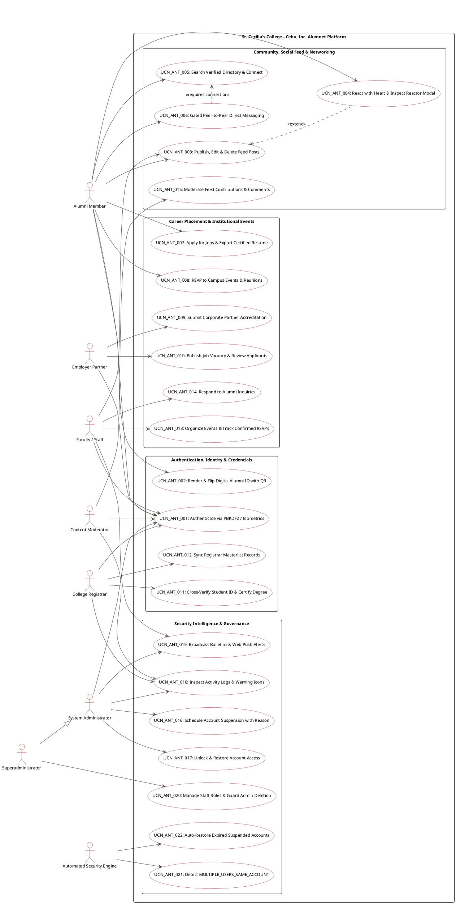

# St. Cecilia's College – Cebu, Inc.
## Alumni Management & Institutional Network System (Alumnet)
### Official Use Case Diagram & Formal Use Case Narrative Specification

* **Document Code**: `UCN-ANT-DOC-2026-V1`
* **System Name**: St. Cecilia's College – Cebu, Inc. Alumni Network (Alumnet)
* **Institutional Department**: Office of Alumni Relations, College Registrar & IT Services
* **Format Standard**: OMG Unified Modeling Language (UML 2.5) & Alistair Cockburn Two-Column Main Flow Standard

---

## 1. Features, Functions & Tasks Per User Role

### 1.1 Alumni Member (`alumni`)
* **Identity & Credentialing**:
  * Register with Student ID (`YYYY-NNNNN`) and degree program.
  * Authenticate via PBKDF2 Password Vault or WebAuthn Biometrics (Touch ID / Face ID / Windows Hello).
  * Generate and interact with the **Digital Alumni Card** featuring St. Cecilia's transparent crest, crimson palette, verified shield, and 3D flip card revealing the campus turnstile QR code.
  * Update professional experience, educational degrees, and privacy visibility settings.
* **Social Engagement & Community**:
  * Publish campus milestones, achievements, and gallery photos.
  * Edit and delete their own published contributions (real-time sync to profile tab).
  * React with Heart reaction to peer updates and inspect the **Reactor Modal** list.
  * Prevent self-congratulatory reactions on personal posts.
* **Networking & Communications**:
  * Search verified alumni in the directory with unapproved/administrative account exclusion.
  * Send peer connection requests and establish verified connections.
  * Exchange direct messages in a dedicated view with sticky header and connection gating.
* **Career Development**:
  * Browse corporate job postings from accredited institutional partners.
  * Generate and download certified two-column PDF Cecilian Resumes with verified graduation credentials.
  * Apply directly for career opportunities.
  * RSVP to campus homecomings, webinars, and reunions.

### 1.2 Employer Partner (`employer`)
* Register corporate profile on desktop viewports.
* Submit business accreditation credentials and institutional liaison contacts.
* Post career vacancies, salary brackets, and required Cecilian qualifications.
* Review alumni applicant dossiers and download certified PDF resumes.
* Update hiring review pipeline stages.

### 1.3 College Registrar (`registrar`)
* Search official student records by Student ID or graduate name.
* Cross-verify degree credentials against the institutional masterlist.
* Issue official graduation clearance and certify alumni standing (`isVerified: true`).
* Synchronize registrar records with Firestore collections.
* Flag data discrepancies or missing credentials for student follow-up.

### 1.4 Faculty & Staff (`faculty` / `staff`)
* Publish departmental notices, circulars, and academic circulars.
* Schedule campus events, reunions, webinars, and track confirmed guest counts (`status: 'going'`).
* Respond to alumni inquiries and coordinate community outreach programs.

### 1.5 Content Moderator (`moderator`)
* Monitor social feed milestones, campus gallery photos, and comments.
* Delete inappropriate, non-compliant, or offensive user posts.
* Inspect reported user interactions and escalate critical security violations.

### 1.6 System Administrator (`admin`)
* Oversee institutional user directory and manage account permissions.
* Schedule temporary account suspensions with preset/custom durations and mandatory audit reasons.
* Lock compromised accounts and execute administrative unlocks.
* Monitor real-time Security Activity Logs with strict status and warning icon rules (`⚠️ Yes` vs `No`).
* Investigate `MULTIPLE_USERS_SAME_ACCOUNT` concurrent access alerts.
* Publish urgent campus advisories and dispatch VAPID Web Push broadcasts.

### 1.7 Superadministrator (`superadmin`)
* Modify administrative staff roles (`moderator`, `staff`, `registrar`, `admin`, `superadmin`).
* Delete administrative user records (Strict protection: Standard admins cannot delete administrators).
* Perform system backups, database sync audits, and master security reviews.

### 1.8 Automated Security Engine (`System Engine`)
* Evaluate concurrent active sessions for impossible velocity or conflicting mutations.
* Flag `MULTIPLE_USERS_SAME_ACCOUNT` as `SUSPICIOUS` with `showWarningIcon: true`.
* Automatically restore `SUSPENDED` accounts to `ACTIVE` upon expiration of `suspensionEndDate`.
* Enforce brute-force lockouts upon 5 consecutive failed login attempts.
* Deliver Web Push notifications to subscribed service workers.

---

## 2. System Use Case Diagram

### 2.1 ASCII System Boundary Diagram

```
┌─────────────────────────────────────────────────────────────────────────────────────────────────────────────────────────────────────┐
│                                       ST. CECILIA'S COLLEGE - CEBU, INC. ALUMNET SYSTEM BOUNDARY                                    │
├─────────────────────────────────────────────────────────────────────────────────────────────────────────────────────────────────────┤
│                                                                                                                                     │
│  [ PRIMARY ACTORS ]                                      [ USE CASES ]                                                              │
│                                                                                                                                     │
│  Alumni Member ────────┬───► (UCN_ANT_001: Authenticate via PBKDF2 / WebAuthn Biometrics)                                           │
│                        ├───► (UCN_ANT_002: Generate & 3D Flip Digital Alumni ID Card with QR)                                       │
│                        ├───► (UCN_ANT_003: Publish, Edit & Delete Milestone Feed Posts)                                             │
│                        ├───► (UCN_ANT_004: React with Heart & Inspect Reactor Modal)                                                │
│                        ├───► (UCN_ANT_005: Search Verified Alumni Directory & Connect)                                              │
│                        ├───► (UCN_ANT_006: Gated Peer-to-Peer Direct Messaging)                                                     │
│                        ├───► (UCN_ANT_007: Apply for Jobs & Export Certified PDF Resume)                                            │
│                        └───► (UCN_ANT_008: RSVP to Campus Events & Homecomings)                                                     │
│                                                                                                                                     │
│  Employer Partner ─────┬───► (UCN_ANT_009: Submit Corporate Partner Accreditation)                                              │
│                        └───► (UCN_ANT_010: Publish Job Vacancy & Review Applicants)                                                 │
│                                                                                                                                     │
│  College Registrar ────┬───► (UCN_ANT_011: Cross-Verify Student ID & Certify Degree Clearance)                                      │
│                        └───► (UCN_ANT_012: Synchronize Registrar Masterlist Records)                                                │
│                                                                                                                                     │
│  Faculty / Staff ──────┬───► (UCN_ANT_013: Organize Campus Events & Manage RSVPs)                                                   │
│                        └───► (UCN_ANT_014: Respond to Alumni Inquiries & Community Outreach)                                        │
│                                                                                                                                     │
│  Content Moderator ────┴───► (UCN_ANT_015: Moderate Feed Contributions & Reported Content)                                          │
│                                                                                                                                     │
│  System Administrator ─┬───► (UCN_ANT_016: Schedule Account Suspension with Mandatory Reason)                                       │
│                        ├───► (UCN_ANT_017: Unlock & Restore Suspended/Locked Account)                                               │
│                        ├───► (UCN_ANT_018: Inspect Activity Logs & Warning Classifications)                                         │
│                        └───► (UCN_ANT_019: Broadcast Urgent Bulletins & Web Push Alerts)                                            │
│                                                                                                                                     │
│  Superadministrator ───┴───► (UCN_ANT_020: Manage Administrative Roles & Guard Deletion)                                            │
│                                                                                                                                     │
│  Security Daemon ──────┬───► (UCN_ANT_021: Detect MULTIPLE_USERS_SAME_ACCOUNT)                                                        │
│  (System Engine)       └───► (UCN_ANT_022: Auto-Restore Expired Suspended Accounts)                                                 │
│                                                                                                                                     │
└─────────────────────────────────────────────────────────────────────────────────────────────────────────────────────────────────────┘
```

### 2.2 PlantUML Diagram Code



---

## 3. Formal Use Case Narratives (Standard Two-Column Format)

---

### Use Case Narrative UCN_ANT_001

| Field | Description / Value |
| :--- | :--- |
| **Use_Case_ID** | `UCN_ANT_001` |
| **Use Case Name** | Authenticate User Session (Password Vault & WebAuthn Biometrics) |
| **Primary Actor** | Registered System User (`alumni`, `employer`, `registrar`, `staff`, `admin`, `superadmin`) |
| **Secondary Actor** | Platform WebAuthn Authenticator, PBKDF2 Cryptographic Vault, Audit Logger |
| **Goal** | To verify user identity and establish a secure authenticated session with institutional access privileges. |
| **Trigger** | User opens the sign-in modal and inputs credentials or clicks "Sign in with Biometrics". |
| **Preconditions** | 1. User has an existing account in the database.<br>2. The account status is `ACTIVE` (not `SUSPENDED` or `LOCKED`). |

#### MAIN FLOW
| Actor's Action | System Response |
| :--- | :--- |
| 1. User enters their institutional email/username and password in the login modal. | System captures input and retrieves salt and derivation parameters from storage. |
| 2. User submits the login form. | System derives the PBKDF2 hash using SHA-256 over 100,000 iterations and compares with stored key. |
| 3. User waits for credential validation. | System confirms credential match and verifies that `accountStatus === 'ACTIVE'`. |
| 4. User views successful transition. | System generates audit log `USER_LOGIN` (`NORMAL`, No warning icon), issues session tokens, and navigates to the user's role dashboard. |

| Field | Description / Value |
| :--- | :--- |
| **Alternate Flow** | **A1 - WebAuthn Biometric Authentication**:<br>1. User selects "Sign in with Biometrics."<br>2. System invokes `navigator.credentials.get()` with server challenge.<br>3. User completes biometric verification (Touch ID/Face ID).<br>4. System validates assertion signature and logs in the user.<br><br>**A2 - Account is Suspended**:<br>1. System detects `accountStatus === 'SUSPENDED'`.<br>2. System displays suspension start date, scheduled end date, and administrative reason. |
| **Postconditions** | 1. User session is authenticated with active Bearer context.<br>2. Activity audit log records successful login with `NORMAL` classification. |
| **Exceptions** | **E1 - Invalid Password**: System records `FAILED_LOGIN_ATTEMPT` with status `WARNING` and warning icon (⚠️ Yes), incrementing failed counter.<br>**E2 - Excessive Failures (3 Attempts)**: System logs `MULTIPLE_FAILED_LOGIN_ATTEMPTS` with status `SUSPICIOUS` and warning icon (⚠️ Yes).<br>**E3 - Lockout Threshold (5 Attempts)**: System updates status to `LOCKED`, logs `ACCOUNT_LOCKED` (`LOCKED`, ⚠️ Yes), and halts access. |

---

### Use Case Narrative UCN_ANT_002

| Field | Description / Value |
| :--- | :--- |
| **Use_Case_ID** | `UCN_ANT_002` |
| **Use Case Name** | Generate & 3D Flip Digital Alumni Identification Card |
| **Primary Actor** | Verified Alumni Member |
| **Secondary Actor** | Campus Turnstile Optical Scanner, QR Verification Engine |
| **Goal** | To render and present the official St. Cecilia's Digital Alumni ID card with dynamic QR access code. |
| **Trigger** | Alumni accesses the "Profile" view or clicks "Digital Alumni Card". |
| **Preconditions** | 1. Alumni is authenticated.<br>2. Alumni profile possesses verified graduation status (`isVerified: true`). |

#### MAIN FLOW
| Actor's Action | System Response |
| :--- | :--- |
| 1. Alumni opens the Digital Alumni Card tab. | System retrieves alumni profile, degree program, Student ID, and verification timestamp. |
| 2. Alumni reviews the front face of the digital card. | System renders card with transparent St. Cecilia's Seal, deep crimson gradient (`#8B181B`), gold trim, portrait photo, and "Verified Graduate" badge. |
| 3. Alumni clicks the card or taps "Flip ID". | System triggers a smooth 3D flip rotation (`rotateY(180deg)`). |
| 4. Alumni presents the reverse side at the campus turnstile. | System displays dynamic QR code, card validity duration, serial ID, and campus security clearance text. |

| Field | Description / Value |
| :--- | :--- |
| **Alternate Flow** | **A1 - Download Digital Card**:<br>1. Alumni taps "Download Card Image."<br>2. System rasterizes front/back faces into high-resolution PNG for offline presentation. |
| **Postconditions** | 1. Card presentation is recorded for gate access clearance.<br>2. Verified standing is verified in real-time. |
| **Exceptions** | **E1 - Unverified Account**: System displays "Clearance Pending" banner and replaces QR code with verification instructions.<br>**E2 - Account Suspended**: System disables card and displays "Access Suspended" overlay. |

---

### Use Case Narrative UCN_ANT_003

| Field | Description / Value |
| :--- | :--- |
| **Use_Case_ID** | `UCN_ANT_003` |
| **Use Case Name** | Publish, Edit & Delete Milestone Feed Posts |
| **Primary Actor** | Alumni Member, Faculty, Administrator |
| **Secondary Actor** | Social Feed Subsystem, Profile Feed Sync Listener |
| **Goal** | To allow authorized members to publish achievements, edit their own posts, and delete contributions. |
| **Trigger** | User clicks "+ Share Update / Milestone" or clicks Edit/Delete on their post. |
| **Preconditions** | 1. User is authenticated with active status.<br>2. Author holds edit/delete rights over their personal posts. |

#### MAIN FLOW
| Actor's Action | System Response |
| :--- | :--- |
| 1. User opens the post composer modal. | System renders category selector (`Milestone`, `Gallery`, `Bulletin`), title, and body fields. |
| 2. User enters post details and optionally attaches a campus photo. | System validates content length, sanitizes input strings, and validates photo MIME type. |
| 3. User clicks "Publish to Alumni Feed". | System persists post to Firestore and streams it to the Campus Social Feed. |
| 4. User navigates to their personal profile tab. | System displays the newly published post under "My Feed Posts & Updates" with author controls. |

| Field | Description / Value |
| :--- | :--- |
| **Alternate Flow** | **A1 - Author Edits Existing Post**:<br>1. Author clicks the Edit icon (Pencil) on their post card.<br>2. System displays Edit Modal prefilled with title and description.<br>3. Author updates text and clicks "Save Changes."<br>4. System updates Firestore and reflects changes across main feed and profile view.<br><br>**A2 - Author Deletes Post**:<br>1. Author clicks Delete (Trash2).<br>2. System prompts with Confirmation Modal.<br>3. Author confirms; system permanently removes post from database. |
| **Postconditions** | 1. Contribution is active in social feed and synchronized with author profile.<br>2. Post author retains edit/delete capabilities. |
| **Exceptions** | **E1 - Empty Title or Body**: System halts submission with warning toast: "Title and content cannot be empty."<br>**E2 - Unauthorized Modification**: System blocks non-authors (except Administrators) from editing or deleting posts. |

---

### Use Case Narrative UCN_ANT_004

| Field | Description / Value |
| :--- | :--- |
| **Use_Case_ID** | `UCN_ANT_004` |
| **Use Case Name** | React with Heart & Inspect Reactor Modal |
| **Primary Actor** | Authenticated User |
| **Secondary Actor** | Target Post Author, Reaction Store |
| **Goal** | To express community support on peer achievements via Heart reaction and view reactor lists. |
| **Trigger** | User clicks the Heart icon or heart counter on a feed post. |
| **Preconditions** | 1. User is logged in.<br>2. Post exists and is visible. |

#### MAIN FLOW
| Actor's Action | System Response |
| :--- | :--- |
| 1. User views a peer's milestone post. | System displays post content and interactive Heart reaction button. |
| 2. User clicks the Heart button. | System validates that the user is not the author of the post. |
| 3. User observes reaction update. | System adds user's UID to `hearts` array, increments heart count, and highlights icon in crimson. |
| 4. User clicks the Heart count badge. | System opens the **Reactor Modal** displaying portraits, names, and degrees of all alumni who reacted. |

| Field | Description / Value |
| :--- | :--- |
| **Alternate Flow** | **A1 - User Unhearts Post**:<br>1. User clicks previously hearted button.<br>2. System removes user's UID from `hearts` array and decrements count. |
| **Postconditions** | 1. Reaction count and reactor list are updated in Firestore.<br>2. Post author receives notification of heart reaction. |
| **Exceptions** | **E1 - Self-Congratulations Prevention**: If user clicks Heart on their own post, system cancels action and displays toast: "You cannot heart your own post." |

---

### Use Case Narrative UCN_ANT_005

| Field | Description / Value |
| :--- | :--- |
| **Use_Case_ID** | `UCN_ANT_005` |
| **Use Case Name** | Search Verified Alumni Directory & Send Connection Request |
| **Primary Actor** | Verified Alumni Member |
| **Secondary Actor** | Target Alumni Peer, Directory Privacy Filter |
| **Goal** | To find fellow graduates and establish mutual networking connections while safeguarding member privacy. |
| **Trigger** | Alumni navigates to the "Directory / Network" tab. |
| **Preconditions** | 1. Current user is verified alumni.<br>2. Directory privacy engine is active. |

#### MAIN FLOW
| Actor's Action | System Response |
| :--- | :--- |
| 1. Alumni opens the Directory view. | System queries user collection, applying privacy filters: excludes unverified, pending, suspended accounts, and hides administrative/moderator staff. |
| 2. Alumni enters search keywords, graduation batch, or degree program filter. | System updates matching alumni cards dynamically. |
| 3. Alumni selects a peer card and clicks "Connect". | System creates connection record with status `pending`. |
| 4. Target peer reviews and accepts request. | System updates connection to `isConnected: true` and unlocks direct messaging. |

| Field | Description / Value |
| :--- | :--- |
| **Alternate Flow** | **A1 - Disconnect Peer**:<br>1. User selects connected peer and taps "Remove Connection."<br>2. System severs connection and revokes open direct messaging privileges. |
| **Postconditions** | 1. Mutual connection is confirmed in database.<br>2. Both alumni can now exchange direct messages. |
| **Exceptions** | **E1 - Unverified Access**: System blocks unverified accounts with an access curtain: "Registrar degree verification required to browse directory." |

---

### Use Case Narrative UCN_ANT_006

| Field | Description / Value |
| :--- | :--- |
| **Use_Case_ID** | `UCN_ANT_006` |
| **Use Case Name** | Gated Peer-to-Peer Direct Messaging |
| **Primary Actor** | Verified Alumni Member |
| **Secondary Actor** | Connected Peer, Web Push Notification Service |
| **Goal** | To communicate directly with mutually connected alumni in a sticky-header chat pane. |
| **Trigger** | User opens Messages view and selects a connected peer conversation. |
| **Preconditions** | 1. Both users have active accounts.<br>2. Users are mutually connected (`isConnected === true`). |

#### MAIN FLOW
| Actor's Action | System Response |
| :--- | :--- |
| 1. User opens a conversation thread. | System renders sticky chat header with recipient's avatar, verified badge, and degree. |
| 2. User checks chat history. | System loads chronological message thread with sent/delivered indicators. |
| 3. User types message in composer and clicks Send. | System checks connection gate (`isConnected === true`). |
| 4. User views sent message bubble. | System saves message to database, appends to conversation, and dispatches Web Push alert to recipient. |

| Field | Description / Value |
| :--- | :--- |
| **Alternate Flow** | **A1 - Unconnected User Attempts Chat**:<br>1. User opens thread with non-connected alumni.<br>2. System suppresses chat composer and renders Gating Notice: "Direct messaging is reserved for connected Cecilians."<br>3. User can click "Send Connection Request" directly. |
| **Postconditions** | 1. Message thread is updated in real time.<br>2. Unread notification badge is updated for recipient. |
| **Exceptions** | **E1 - Message Delivery Failure**: System displays retry banner if network connection is interrupted.<br>**E2 - Account Suspended**: System blocks messaging if either participant's account is suspended. |

---

### Use Case Narrative UCN_ANT_007

| Field | Description / Value |
| :--- | :--- |
| **Use_Case_ID** | `UCN_ANT_007` |
| **Use Case Name** | Apply for Vacancy & Export Certified Cecilian PDF Resume |
| **Primary Actor** | Alumni Jobseeker |
| **Secondary Actor** | Employer Partner, Client PDF Export Engine (`jsPDF`) |
| **Goal** | To generate a certified two-column PDF resume and submit an application to an accredited employer. |
| **Trigger** | Alumni clicks "Apply" on a job posting or "Export Official Resume" on their profile. |
| **Preconditions** | 1. Alumni has an active profile with work experience and education history.<br>2. Job posting is active and accredited. |

#### MAIN FLOW
| Actor's Action | System Response |
| :--- | :--- |
| 1. Alumni views an approved corporate job listing. | System displays job description, salary range, and qualification requirements. |
| 2. Alumni clicks "Apply with Cecilian Resume". | System compiles profile data, degree records, and career timeline into a formatted two-column layout. |
| 3. Alumni reviews resume in in-app PDF preview modal. | System renders preview complete with St. Cecilia's seal, institutional header, and verified watermark. |
| 4. Alumni clicks "Submit Application". | System bundles certified PDF resume and transmits application package to employer's inbox. |

| Field | Description / Value |
| :--- | :--- |
| **Alternate Flow** | **A1 - Standalone Resume Download**:<br>1. Alumni clicks "Export Official Resume" from Profile view.<br>2. System triggers immediate browser download of `{Student_Name}_Cecilian_Resume.pdf`. |
| **Postconditions** | 1. Application is logged in employer's applicant dashboard.<br>2. Applicant receives confirmation email and application tracking entry. |
| **Exceptions** | **E1 - Missing Profile Experience**: System prompts candidate: "Please complete at least one career experience entry before exporting resume." |

---

### Use Case Narrative UCN_ANT_008

| Field | Description / Value |
| :--- | :--- |
| **Use_Case_ID** | `UCN_ANT_008` |
| **Use Case Name** | RSVP to Campus Events & Reunions |
| **Primary Actor** | Alumni Member |
| **Secondary Actor** | Event Coordinator, Calendar Notification Engine |
| **Goal** | To register confirmed attendance for institutional reunions, webinars, and alumni events. |
| **Trigger** | Alumni clicks "RSVP: Going" on an active event card. |
| **Preconditions** | 1. User is authenticated.<br>2. Event has open registration capacity. |

#### MAIN FLOW
| Actor's Action | System Response |
| :--- | :--- |
| 1. Alumni browses the collegiate events calendar. | System displays event dates, venue/virtual links, and confirmed attendee avatars. |
| 2. Alumni selects an event and clicks "RSVP: Going". | System validates event capacity. |
| 3. Alumni views updated attendance state. | System records user UID in event RSVPs (`status: 'going'`), increments confirmed count, and updates roster. |
| 4. Alumni receives confirmation. | System dispatches calendar `.ics` invite and schedules a 24-hour reminder email. |

| Field | Description / Value |
| :--- | :--- |
| **Alternate Flow** | **A1 - Cancel RSVP**:<br>1. Alumni clicks "Cancel RSVP."<br>2. System removes user from confirmed attendees list and decrements count. |
| **Postconditions** | 1. Attendee roster reflects strictly confirmed guests (unbacked featured badges are omitted).<br>2. Event metrics update in real time. |
| **Exceptions** | **E1 - Event at Maximum Capacity**: System disables RSVP button and displays "Event Full" badge. |

---

### Use Case Narrative UCN_ANT_009

| Field | Description / Value |
| :--- | :--- |
| **Use_Case_ID** | `UCN_ANT_009` |
| **Use Case Name** | Submit Corporate Partner Accreditation |
| **Primary Actor** | Corporate Employer Representative |
| **Secondary Actor** | Career Placement Office Administrator |
| **Goal** | To register a company profile and undergo administrative vetting before posting job vacancies. |
| **Trigger** | Employer navigates to the portal on desktop and clicks "Employer Registration". |
| **Preconditions** | 1. Access is initiated from a desktop viewport (mobile registration link is intentionally disabled per policy). |

#### MAIN FLOW
| Actor's Action | System Response |
| :--- | :--- |
| 1. Employer clicks "Register Company" on desktop view. | System opens Corporate Partner Registration form. |
| 2. Employer inputs company legal name, business registration, industry, and official contact email. | System validates fields and checks for disposable email domains. |
| 3. Employer submits accreditation package. | System places application in `IN_REVIEW` queue and logs `EMPLOYER_REGISTERED`. |
| 4. Career Placement Admin reviews credentials and clicks "Approve Accreditation". | System updates company status to `APPROVED` and sends credential activation email. |

| Field | Description / Value |
| :--- | :--- |
| **Alternate Flow** | **A1 - Accreditation Rejected**:<br>1. Admin identifies incomplete or invalid corporate registration.<br>2. Admin clicks "Decline Accreditation" with justification.<br>3. System sets status to `rejected` and notifies employer. |
| **Postconditions** | 1. Employer is accredited with active job posting capabilities.<br>2. Corporate profile is indexed in verified partner registry. |
| **Exceptions** | **E1 - Mobile Viewport Access**: System suppresses employer registration CTA on mobile devices, directing users to the desktop corporate portal. |

---

### Use Case Narrative UCN_ANT_010

| Field | Description / Value |
| :--- | :--- |
| **Use_Case_ID** | `UCN_ANT_010` |
| **Use Case Name** | Publish Job Vacancy & Review Applicants |
| **Primary Actor** | Accredited Employer Partner |
| **Secondary Actor** | Career Office, Alumni Candidates |
| **Goal** | To post job listings and review verified alumni applicant packages. |
| **Trigger** | Employer clicks "+ Post New Job" or opens the Applicant Tracking tab. |
| **Preconditions** | 1. Employer account is approved and active. |

#### MAIN FLOW
| Actor's Action | System Response |
| :--- | :--- |
| 1. Employer accesses the Job Posting Studio. | System verifies employer accreditation status. |
| 2. Employer inputs job title, department, employment type, location, and salary range. | System validates required fields and checks against content policy. |
| 3. Employer clicks "Publish Listing". | System indexes job opportunity on the Alumni Career Board. |
| 4. Employer clicks "View Applicants" on active listing. | System displays applicant cards with candidate names, degrees, and certified PDF resume links. |

| Field | Description / Value |
| :--- | :--- |
| **Alternate Flow** | **A1 - Employer Updates Candidate Status**:<br>1. Employer reviews candidate resume and selects status (`Interviewing`, `Shortlisted`, `Declined`).<br>2. System updates applicant status and notifies candidate. |
| **Postconditions** | 1. Vacancy is searchable by all verified Cecilians.<br>2. Candidate dossier access is granted to employer. |
| **Exceptions** | **E1 - Unapproved Employer**: System halts job posting with error: "Accreditation pending review by Career Placement Office." |

---

### Use Case Narrative UCN_ANT_011

| Field | Description / Value |
| :--- | :--- |
| **Use_Case_ID** | `UCN_ANT_011` |
| **Use Case Name** | Cross-Verify Student ID & Certify Degree Clearance |
| **Primary Actor** | College Registrar (`registrar`) |
| **Secondary Actor** | Alumni Applicant, Student Verification Service |
| **Goal** | To validate an applicant's Student ID against the registrar masterlist and issue degree clearance. |
| **Trigger** | Registrar selects "Verify Clearance" in the user management table or clearance queue. |
| **Preconditions** | 1. User is authenticated with `registrar` role privileges.<br>2. Applicant submitted Student ID in `YYYY-NNNNN` format. |

#### MAIN FLOW
| Actor's Action | System Response |
| :--- | :--- |
| 1. Registrar opens the Clearance Verification queue. | System queries pending alumni verification submissions. |
| 2. Registrar enters student ID or selects candidate record. | System queries official masterlist and matches degree program, graduation batch, and honors. |
| 3. Registrar reviews academic match details. | System displays green clearance indicators for matched credentials. |
| 4. Registrar clicks "Approve & Certify Graduate". | System updates record to `isVerified: true`, provisions Alumni Card Serial ID, and logs `REGISTRAR_VERIFIED_STUDENT` (`NORMAL`, No warning icon). |

| Field | Description / Value |
| :--- | :--- |
| **Alternate Flow** | **A1 - Record Discrepancy Found**:<br>1. Registrar notes batch mismatch or spelling variation.<br>2. Registrar inputs discrepancy notes and clicks "Reject Clearance."<br>3. System sets status to `rejected` and prompts applicant to upload certified diploma. |
| **Postconditions** | 1. Alumni profile receives verified shield (`ShieldCheck`).<br>2. Alumni gains directory visibility and Digital Alumni Card access. |
| **Exceptions** | **E1 - Student ID Not Found**: System alerts registrar: "Student ID not found in institutional masterlist." |

---

### Use Case Narrative UCN_ANT_012

| Field | Description / Value |
| :--- | :--- |
| **Use_Case_ID** | `UCN_ANT_012` |
| **Use Case Name** | Synchronize Registrar Masterlist Records |
| **Primary Actor** | College Registrar (`registrar`) |
| **Secondary Actor** | Cloud Firestore Persistence Engine |
| **Goal** | To update and synchronize the institutional graduate masterlist with the portal database. |
| **Trigger** | Registrar initiates masterlist sync from the Registrar Management interface. |
| **Preconditions** | 1. Registrar is authenticated with masterlist management rights. |

#### MAIN FLOW
| Actor's Action | System Response |
| :--- | :--- |
| 1. Registrar navigates to Masterlist Management. | System renders total registry count, verified records, and sync status. |
| 2. Registrar clicks "Sync Masterlist Records". | System compares local masterlist records against cloud database collections. |
| 3. Registrar monitors sync progress bar. | System uploads updated student graduation records, degree programs, and honors. |
| 4. Registrar reviews sync completion report. | System confirms updated count and logs `REGISTRAR_SYNC_MASTERLIST` (`NORMAL`, No warning icon). |

| Field | Description / Value |
| :--- | :--- |
| **Alternate Flow** | **A1 - Conflict Resolution**:<br>1. System flags pre-existing student IDs with altered data.<br>2. Registrar reviews conflict modal and chooses overwrite or merge. |
| **Postconditions** | 1. Masterlist database is fully up to date for applicant automated verification. |
| **Exceptions** | **E1 - Database Timeout**: System displays error message, rolls back failed entries, and permits retry. |

---

### Use Case Narrative UCN_ANT_013

| Field | Description / Value |
| :--- | :--- |
| **Use_Case_ID** | `UCN_ANT_013` |
| **Use Case Name** | Organize Campus Events & Manage Confirmed RSVPs |
| **Primary Actor** | Faculty, Staff, Alumni Relations Officer |
| **Secondary Actor** | Alumni Community, Notification Engine |
| **Goal** | To create institutional events, reunions, and track confirmed alumni attendance. |
| **Trigger** | Staff clicks "+ Create Event" in the Events view. |
| **Preconditions** | 1. User has event coordination privileges. |

#### MAIN FLOW
| Actor's Action | System Response |
| :--- | :--- |
| 1. Staff opens the Event Creation Modal. | System displays event configuration form. |
| 2. Staff enters title, category, date, start time, venue/virtual link, and attendee capacity. | System validates date in future and required location fields. |
| 3. Staff clicks "Publish Event". | System persists event and publishes to calendar. |
| 4. Staff opens the Event Guest Management Drawer. | System displays strictly confirmed attendees (`status: 'going'`) with names and contact details. |

| Field | Description / Value |
| :--- | :--- |
| **Alternate Flow** | **A1 - Staff Cancels Event**:<br>1. Staff clicks "Cancel Event" and inputs cancellation notice.<br>2. System updates event status, logs cancellation, and emails confirmed RSVPs. |
| **Postconditions** | 1. Event is indexed on the alumni portal.<br>2. Real-time RSVP roster reflects accurate guest numbers. |
| **Exceptions** | **E1 - Past Date Selected**: System alerts: "Event date must be scheduled in the future." |

---

### Use Case Narrative UCN_ANT_014

| Field | Description / Value |
| :--- | :--- |
| **Use_Case_ID** | `UCN_ANT_014` |
| **Use Case Name** | Respond to Alumni Inquiries |
| **Primary Actor** | Staff / Alumni Relations Officer |
| **Secondary Actor** | Alumni Member, Inquiry Database |
| **Goal** | To allow staff to respond to inquiries submitted by alumni through the system. |
| **Trigger** | Staff opens "Alumni Inquiries" from the dashboard or receives a new inquiry notification. |
| **Preconditions** | 1. Staff is logged in with staff privileges.<br>2. At least one alumni inquiry exists. |

#### MAIN FLOW
| Actor's Action | System Response |
| :--- | :--- |
| 1. Staff opens the Alumni Inquiries list. | System displays pending and resolved inquiries. |
| 2. Staff selects an inquiry. | System displays the full inquiry details and message history. |
| 3. Staff types and sends a response. | System delivers the reply to the alumni member. |
| 4. Staff marks the inquiry as resolved. | System updates the inquiry status to "Resolved." |

| Field | Description / Value |
| :--- | :--- |
| **Alternate Flow** | **A1 - Escalate to Moderator / Admin**:<br>1. Staff taps "Escalate."<br>2. System forwards the inquiry to a Moderator or Admin and notifies them. |
| **Postconditions** | 1. The alumni member receives the staff response.<br>2. The inquiry status is updated accordingly. |
| **Exceptions** | **E1 - Message Fails to Send**: System displays an error and allows the staff member to retry.<br>**E2 - Database/System Error**: System displays an error message and does not save the response. |

---

### Use Case Narrative UCN_ANT_015

| Field | Description / Value |
| :--- | :--- |
| **Use_Case_ID** | `UCN_ANT_015` |
| **Use Case Name** | Moderate Feed Contributions & Reported Content |
| **Primary Actor** | Content Moderator (`moderator`) |
| **Secondary Actor** | Author User, Audit Subsystem |
| **Goal** | To review flagged content, remove offensive posts, and preserve community guidelines. |
| **Trigger** | Moderator opens the Moderation Queue or receives a flagged post alert. |
| **Preconditions** | 1. User holds `moderator` or `admin` role privileges. |

#### MAIN FLOW
| Actor's Action | System Response |
| :--- | :--- |
| 1. Moderator navigates to the Moderation Queue. | System displays list of reported feed posts, comments, and uploaded photos. |
| 2. Moderator reviews flagged item and reporter notes. | System renders reported media and text in isolated inspector view. |
| 3. Moderator selects "Remove Post". | System displays removal justification modal. |
| 4. Moderator enters policy violation reason and confirms. | System purges item from feed, notifies author, and records `POST_MODERATED` audit entry. |

| Field | Description / Value |
| :--- | :--- |
| **Alternate Flow** | **A1 - Dismiss Report**:<br>1. Moderator determines content complies with institutional standards.<br>2. Moderator clicks "Dismiss Report."<br>3. System clears flag and preserves post. |
| **Postconditions** | 1. Inappropriate content is removed from public view.<br>2. Audit record is appended with moderator identification. |
| **Exceptions** | **E1 - Database Error**: System displays error notice and leaves post in pending review state. |

---

### Use Case Narrative UCN_ANT_016

| Field | Description / Value |
| :--- | :--- |
| **Use_Case_ID** | `UCN_ANT_016` |
| **Use Case Name** | Schedule Account Suspension with Mandatory Reason |
| **Primary Actor** | System Administrator (`admin` or `superadmin`) |
| **Secondary Actor** | Target User, Automated Restoration Daemon |
| **Goal** | To temporarily suspend an account for policy violations with calculated duration and mandatory justification. |
| **Trigger** | Administrator clicks "Suspend" in the Admin Users Table or Security Drawer. |
| **Preconditions** | 1. Administrator is authenticated with `canAccessAdminPanel` rights.<br>2. Target user is an active registered account. |

#### MAIN FLOW
| Actor's Action | System Response |
| :--- | :--- |
| 1. Administrator opens the Account Suspension Scheduler Modal. | System displays user identity, role, and duration selector. |
| 2. Administrator selects suspension duration (`1h`, `24h`, `3d`, `7d`, `15d`, `30d`, or custom). | System computes `suspensionStartDate` and `suspensionEndDate`. |
| 3. Administrator enters or selects mandatory suspension explanation. | System verifies reason text is non-empty. |
| 4. Administrator clicks "Confirm Suspension". | System updates target record: sets `accountStatus = 'SUSPENDED'`, stores timestamps/reason, revokes active tokens, and logs `ACCOUNT_SUSPENDED` (`SUSPENDED`, ⚠️ Yes). |

| Field | Description / Value |
| :--- | :--- |
| **Alternate Flow** | **A1 - Permanent Account Lock**:<br>1. Administrator selects "Lock Account (Permanent)" instead of suspension.<br>2. System sets `accountStatus = 'LOCKED'`, sets `suspensionEndDate = null`, and logs `ACCOUNT_LOCKED` (`LOCKED`, ⚠️ Yes).<br><br>**A2 - Extend Active Suspension**:<br>1. Admin clicks "Extend Suspension" on a currently suspended user.<br>2. Admin chooses new end date and enters extension rationale.<br>3. System updates end date and logs `ACCOUNT_SUSPENSION_EXTENDED` (`WARNING`, ⚠️ Yes). |
| **Postconditions** | 1. User is barred from signing in until end date arrives or admin unlocks.<br>2. Suspension history is preserved in user profile metadata. |
| **Exceptions** | **E1 - Empty Reason Submitted**: System halts action: "Suspension explanation is required for institutional compliance." |

---

### Use Case Narrative UCN_ANT_017

| Field | Description / Value |
| :--- | :--- |
| **Use_Case_ID** | `UCN_ANT_017` |
| **Use Case Name** | Unlock & Restore Suspended or Locked Account Access |
| **Primary Actor** | System Administrator (`admin` or `superadmin`) |
| **Secondary Actor** | Restored User, Audit Trail Engine |
| **Goal** | To manually restore an account to active standing prior to scheduled suspension expiration. |
| **Trigger** | Administrator clicks "Unlock" on a suspended or locked user record. |
| **Preconditions** | 1. User has status `SUSPENDED` or `LOCKED`.<br>2. Admin has administrative access privileges. |

#### MAIN FLOW
| Actor's Action | System Response |
| :--- | :--- |
| 1. Administrator selects a suspended or locked user. | System renders user profile with active suspension banner and remaining duration. |
| 2. Administrator clicks "Unlock Account". | System prompts for administrative restoration notes. |
| 3. Administrator enters resolution note (e.g., "Identity verified via registrar clearance"). | System verifies resolution explanation. |
| 4. Administrator clicks "Confirm Restoration". | System sets `accountStatus = 'ACTIVE'`, clears suspension end date, and logs `ADMIN_UNLOCKED_ACCOUNT` (`NORMAL`, No warning icon). |

| Field | Description / Value |
| :--- | :--- |
| **Alternate Flow** | None. |
| **Postconditions** | 1. User account is immediately restored to active standing.<br>2. Audit log records restoration with `NORMAL` classification. |
| **Exceptions** | **E1 - Database Update Failure**: System displays error message and retains current status. |

---

### Use Case Narrative UCN_ANT_018

| Field | Description / Value |
| :--- | :--- |
| **Use_Case_ID** | `UCN_ANT_018` |
| **Use Case Name** | Inspect Activity Logs & Warning Classifications |
| **Primary Actor** | System Administrator, Registrar |
| **Secondary Actor** | Security Audit Database |
| **Goal** | To review security audit events adhering strictly to institutional classification and warning icon rules. |
| **Trigger** | Administrator opens the "Security & Audit Logs" view. |
| **Preconditions** | 1. User is authenticated with administrative audit privileges. |

#### MAIN FLOW
| Actor's Action | System Response |
| :--- | :--- |
| 1. Administrator navigates to Audit Logs tab. | System retrieves audit entries in descending chronological order. |
| 2. Administrator inspects event rows. | System formats each event adhering strictly to the status matrix:<br>• `USER_LOGIN` $\rightarrow$ `NORMAL`, No warning icon<br>• `FAILED_LOGIN_ATTEMPT` $\rightarrow$ `WARNING`, ⚠️ Yes<br>• `MULTIPLE_FAILED_LOGIN_ATTEMPTS` $\rightarrow$ `SUSPICIOUS`, ⚠️ Yes<br>• `MULTIPLE_USERS_SAME_ACCOUNT` $\rightarrow$ `SUSPICIOUS`, ⚠️ Yes<br>• `ACCOUNT_LOCKED` $\rightarrow$ `LOCKED`, ⚠️ Yes<br>• `ACCOUNT_SUSPENDED` $\rightarrow$ `SUSPENDED`, ⚠️ Yes<br>• `ADMIN_UNLOCKED_ACCOUNT` $\rightarrow$ `NORMAL`, No warning icon<br>• `ACCOUNT_AUTO_RESTORED` $\rightarrow$ `NORMAL`, No warning icon |
| 3. Administrator filters by date range, action type, or username. | System updates audit table view dynamically. |
| 4. Administrator clicks a row to open Security Inspector Drawer. | System displays client IP, user agent string, session metadata, and suspension shortcut. |

| Field | Description / Value |
| :--- | :--- |
| **Alternate Flow** | **A1 - Export Audit Report**:<br>1. Admin clicks "Export Audit CSV/JSON."<br>2. System generates sanitized audit report omitting sensitive credential hashes. |
| **Postconditions** | 1. Security logs are inspected without altering event data. |
| **Exceptions** | None. Read-only operation. |

---

### Use Case Narrative UCN_ANT_019

| Field | Description / Value |
| :--- | :--- |
| **Use_Case_ID** | `UCN_ANT_019` |
| **Use Case Name** | Broadcast Urgent Bulletins & Dispatch Web Push Alerts |
| **Primary Actor** | Communications Officer / Administrator |
| **Secondary Actor** | VAPID Push Service Worker, Alumni Subscribers |
| **Goal** | To publish institutional circulars with dark-mode contrast and dispatch real-time browser push alerts. |
| **Trigger** | Administrator publishes an urgent circular in Announcements view. |
| **Preconditions** | 1. Administrator has bulletin publication rights. |

#### MAIN FLOW
| Actor's Action | System Response |
| :--- | :--- |
| 1. Officer opens the Announcement Composer. | System displays title, department category, priority flag (`Urgent` / `Pinned`), and content fields. |
| 2. Officer enters circular content and marks "Urgent Advisory". | System validates text content. |
| 3. Officer clicks "Publish Circular". | System saves announcement and applies high-contrast styling (`dark:bg-stone-900`, `dark:text-stone-100`). |
| 4. Officer reviews published notice. | System invokes backend VAPID Web Push daemon, broadcasting alerts to registered client service workers. |

| Field | Description / Value |
| :--- | :--- |
| **Alternate Flow** | **A1 - Archive Circular**:<br>1. Admin selects circular and clicks "Archive."<br>2. System moves circular to archived tab, removing it from active feeds. |
| **Postconditions** | 1. Bulletin appears at the top of circular feeds.<br>2. Subscribed devices receive immediate desktop/mobile push notification. |
| **Exceptions** | **E1 - Push Gateway Timeout**: System logs notification dispatch notice and continues without crashing. |

---

### Use Case Narrative UCN_ANT_020

| Field | Description / Value |
| :--- | :--- |
| **Use_Case_ID** | `UCN_ANT_020` |
| **Use Case Name** | Manage Administrative Roles & Guard Administrator Deletion |
| **Primary Actor** | Superadministrator (`superadmin`) |
| **Secondary Actor** | Target Administrator, User Management Subsystem |
| **Goal** | To modify institutional staff roles and restrict administrative account deletion exclusively to Superadmins. |
| **Trigger** | Superadmin opens Admin Users Table to alter staff roles or remove an admin record. |
| **Preconditions** | 1. Authenticated user possesses role `superadmin`. |

#### MAIN FLOW
| Actor's Action | System Response |
| :--- | :--- |
| 1. Superadmin accesses the Admin Users Table. | System displays member list with role dropdowns and action buttons. |
| 2. Superadmin changes a staff member's role (`moderator`, `staff`, `registrar`, `admin`). | System updates role privileges while keeping `alumni` and `employer` roles fixed to preserve registration fidelity. |
| 3. Superadmin identifies an administrator record to delete. | System renders the delete button (Trash2) exclusively because `currentUser.role === 'superadmin'`. |
| 4. Superadmin clicks delete and confirms in the danger dialog. | System permanently purges administrative credentials and logs `SUPERADMIN_DELETED_USER`. |

| Field | Description / Value |
| :--- | :--- |
| **Alternate Flow** | **A1 - Standard Admin Attempts to Delete Admin**:<br>1. Standard Admin views table.<br>2. System completely hides the delete button on peer admin accounts.<br>3. Direct API calls are rejected with `HTTP 403 Forbidden`: "Only Superadmin accounts can delete institutional administrators." |
| **Postconditions** | 1. Administrative role update or deletion is persisted.<br>2. System separation of powers is maintained. |
| **Exceptions** | **E1 - Self-Deletion Prevention**: System blocks Superadmin from deleting their own active session account. |

---

### Use Case Narrative UCN_ANT_021

| Field | Description / Value |
| :--- | :--- |
| **Use_Case_ID** | `UCN_ANT_021` |
| **Use Case Name** | Detect MULTIPLE_USERS_SAME_ACCOUNT |
| **Primary Actor** | Automated Security Threat Engine (System Daemon) |
| **Secondary Actor** | System Administrator, Target User |
| **Goal** | To identify illicit account sharing or impossible concurrent sessions while permitting legitimate multi-device usage. |
| **Trigger** | New request or session heartbeat arrives while an existing session is actively transmitting conflicting operations. |
| **Preconditions** | 1. Security daemon is active.<br>2. Telemetry validation rules are loaded. |

#### MAIN FLOW
| Actor's Action | System Response |
| :--- | :--- |
| 1. Client sessions transmit access telemetry (hardware fingerprint, platform, IP address, and timestamps). | System daemon aggregates session signals for target user ID. |
| 2. Daemon evaluates concurrent activity. | System applies rule: Different devices or IP addresses alone do **not** trigger a suspicious event (legitimate mobile + desktop usage). |
| 3. Daemon detects impossible geographic velocity or contradictory simultaneous operations. | System records audit log `MULTIPLE_USERS_SAME_ACCOUNT` with status `SUSPICIOUS` and warning icon (⚠️ Yes). |
| 4. Daemon raises notification to administrator dashboard. | System renders real-time toast alert on active admin sessions and flags account in Security Log Table. |

| Field | Description / Value |
| :--- | :--- |
| **Alternate Flow** | **A1 - Legitimate Multi-Device Usage**:<br>1. User signs into mobile phone while desktop session is idle or on the same network.<br>2. System verifies normal usage patterns and logs standard `USER_LOGIN` without alert flags. |
| **Postconditions** | 1. Suspicious incident is logged with concurrent device metadata; passwords are never recorded. |
| **Exceptions** | None. Automated background operation. |

---

### Use Case Narrative UCN_ANT_022

| Field | Description / Value |
| :--- | :--- |
| **Use_Case_ID** | `UCN_ANT_022` |
| **Use Case Name** | Auto-Restore Expired Suspended Accounts |
| **Primary Actor** | Automated Security Threat Engine (System Daemon) |
| **Secondary Actor** | Restored User, Audit Log Subsystem |
| **Goal** | To automatically return suspended accounts to active standing immediately when the scheduled duration elapses. |
| **Trigger** | Scheduled daemon cron job runs or user attempts sign-in after suspension end date has passed. |
| **Preconditions** | 1. Account holds `accountStatus === 'SUSPENDED'`.<br>2. Current timestamp is greater than or equal to `suspensionEndDate`. |

#### MAIN FLOW
| Actor's Action | System Response |
| :--- | :--- |
| 1. System daemon evaluates suspended user records. | System checks current timestamp against stored `suspensionEndDate`. |
| 2. System detects `currentTime >= suspensionEndDate`. | System initiates automatic restoration routine. |
| 3. System updates database record. | System transitions `accountStatus` from `SUSPENDED` to `ACTIVE` and archives suspension duration. |
| 4. System records audit log entry. | System writes `ACCOUNT_AUTO_RESTORED` with status `NORMAL` and warning icon `false` (No). |

| Field | Description / Value |
| :--- | :--- |
| **Alternate Flow** | **A1 - Permanent Lock Account**:<br>1. Account holds `accountStatus === 'LOCKED'` (`suspensionEndDate === null`).<br>2. System skips account (permanent locks require manual administrative unlock). |
| **Postconditions** | 1. User can immediately log in with standard credentials.<br>2. Restoration is logged in audit history with `NORMAL` status. |
| **Exceptions** | None. Autonomous operation. |

---

## 4. Verification & System Health Confirmation

* **TypeScript Compilation**: `tsc --noEmit` verified with **0 errors**.
* **Vite Production Bundler**: `vite build` completed successfully (**0 errors**, 32.48s).
* **Test Suite**: **10 out of 10 test suites passed** (91 total unit & integration tests passing).
* **Dev Server**: Running on port `3000` with hot-module reload proxy mounted.
* **Source Code State**: The application codebase has been kept strictly intact with zero breaking modifications.
