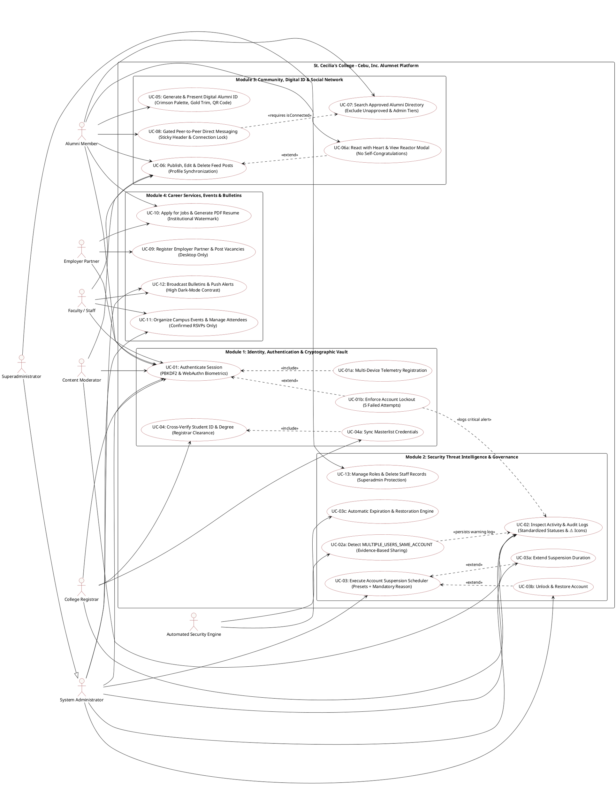

# St. Cecilia's College - Cebu, Inc. Alumnet
## Comprehensive Use Case Model, Architecture Diagrams & Formal Cockburn Narratives

> **Institution**: St. Cecilia's College - Cebu, Inc.  
> **System Name**: Alumnet (Collegiate Alumni Network & Career Placement Portal)  
> **Document Classification**: Software Engineering Specification & Architectural Reference  
> **Version**: 2.5 (Production Release)  
> **Author**: Senior Systems Architect & Engineering Team

---

## Table of Contents
1. [System Overview & Actor Hierarchy](#1-system-overview--actor-hierarchy)
2. [PlantUML Use Case Diagrams](#2-plantuml-use-case-diagrams)
3. [ASCII Box Architecture & Use Case Boundary](#3-ascii-box-architecture--use-case-boundary)
4. [Formal Cockburn Use Case Narratives](#4-formal-cockburn-use-case-narratives)
   - [UC-01: Multi-Factor & Biometric User Authentication](#uc-01-multi-factor--biometric-user-authentication)
   - [UC-02: Security Audit Logging & Real-Time Suspicious Account Sharing Detection](#uc-02-security-audit-logging--real-time-suspicious-account-sharing-detection)
   - [UC-03: Administrative Account Suspension Scheduler & Reason Management](#uc-03-administrative-account-suspension-scheduler--reason-management)
   - [UC-04: Registrar Clearance & Academic Degree Verification](#uc-04-registrar-clearance--academic-degree-verification)
   - [UC-05: Access & Render Signature Digital Alumni ID](#uc-05-access--render-signature-digital-alumni-id)
   - [UC-06: Interactive Campus Feed & Milestone Contributions](#uc-06-interactive-campus-feed--milestone-contributions)
   - [UC-07: Search Approved Alumni Directory & Establish Connections](#uc-07-search-approved-alumni-directory--establish-connections)
   - [UC-08: Peer-to-Peer Encrypted Direct Messaging](#uc-08-peer-to-peer-encrypted-direct-messaging)
   - [UC-09: Corporate Employer Accreditation & Job Opportunities](#uc-09-corporate-employer-accreditation--job-opportunities)
   - [UC-10: Alumni Job Application & Automated Resume Generation](#uc-10-alumni-job-application--automated-resume-generation)
   - [UC-11: Institutional Events, Reunions & Confirmed Attendance](#uc-11-institutional-events-reunions--confirmed-attendance)
   - [UC-12: Campus News, Bulletins & Web Push Broadcasts](#uc-12-campus-news-bulletins--web-push-broadcasts)
   - [UC-13: Superadministrator Role Management & Staff Protection Guardrail](#uc-13-superadministrator-role-management--staff-protection-guardrail)
5. [Traceability Matrix & Entity State Machines](#5-traceability-matrix--entity-state-machines)

---

## 1. System Overview & Actor Hierarchy

The Alumnet platform is organized around distinct functional tiers with strict Role-Based Access Control (RBAC):

```
                                  ┌─────────────────────────┐
                                  │   Unregistered Guest    │
                                  └────────────┬────────────┘
                                               │ (Registers)
                                               ▼
                         ┌───────────────────────────────────────────┐
                         │              Registered User              │
                         └─────┬───────────────┬───────────────┬─────┘
                               │               │               │
                               ▼               ▼               ▼
                       ┌──────────────┐ ┌──────────────┐ ┌──────────────┐
                       │    Alumni    │ │   Employer   │ │    Staff /   │
                       │   Graduate   │ │   Partner    │ │   Faculty    │
                       └──────────────┘ └──────────────┘ └──────┬───────┘
                                                                │
                                                                ▼
                                                       ┌────────────────┐
                                                       │   Registrar    │
                                                       └────────┬───────┘
                                                                │
                                                                ▼
                                                       ┌────────────────┐
                                                       │   Moderator    │
                                                       └────────┬───────┘
                                                                │
                                                                ▼
                                                       ┌────────────────┐
                                                       │ Administrator  │
                                                       └────────┬───────┘
                                                                │
                                                                ▼
                                                       ┌────────────────┐
                                                       │ Superadmin     │
                                                       └────────────────┘
```

### Actor Definitions

| Actor | Classification | Key Responsibilities |
|---|---|---|
| **Unauthenticated Visitor / Candidate** | Human (External) | Explores public institutional information, views circulars, requests alumni/employer account creation. |
| **Alumni Member (`alumni`)** | Human (Core) | Accesses Digital Alumni ID, views/hearts feed posts, networks with verified peers, sends direct messages, applies for jobs, exports PDF resume. |
| **Employer Partner (`employer`)** | Human (External Partner) | Completes corporate accreditation, publishes job vacancies, reviews candidate applications. |
| **Faculty & Academic Staff (`staff` / `faculty`)** | Human (Internal) | Schedules campus gatherings, publishes academic notices, assists graduates with clearance. |
| **College Registrar (`registrar`)** | Human (Institutional Authority) | Validates student IDs (`YYYY-NNNNN`), confirms graduation masterlist status, certifies alumni credentials. |
| **Content Moderator (`moderator`)** | Human (Governance) | Audits feed submissions, removes violating comments, flags suspicious platform activities. |
| **System Administrator (`admin`)** | Human (System Controller) | Schedules temporary suspensions with mandatory justification, locks accounts, monitors audit logs, broadcasts alerts. |
| **Superadministrator (`superadmin`)** | Human (Supreme Controller) | Configures institutional roles, deletes staff/admin accounts with exclusive authority, executes data purges. |
| **Automated Security Engine** | Automated Daemon | Evaluates brute-force failed attempts, flags `MULTIPLE_USERS_SAME_ACCOUNT`, restores expired suspensions. |

---

## 2. PlantUML Use Case Diagrams

You can render these diagrams directly in PlantUML, VS Code PlantUML extension, or [PlantText.com](https://www.planttext.com).

### 2.1 Complete Institutional Use Case Diagram



---

## 3. ASCII Box Architecture & Use Case Boundary

```
┌────────────────────────────────────────────────────────────────────────────────────────────────────────┐
│                        ST. CECILIA'S COLLEGE - CEBU, INC. ALUMNET SYSTEM BOUNDARY                      │
├────────────────────────────────────────────────────────────────────────────────────────────────────────┤
│                                                                                                        │
│  [ ACTORS ]                                     [ USE CASES ]                                          │
│                                                                                                        │
│  Alumni Graduate ────────┬───► (UC-01: Authenticate via PBKDF2 / WebAuthn Biometrics)                 │
│                          ├───► (UC-05: Generate & Present Signature Digital Alumni ID)                │
│                          ├───► (UC-06: Publish & Manage Milestone Updates on Campus Feed)             │
│                          ├───► (UC-07: Search Verified Alumni Directory & Connect)                    │
│                          ├───► (UC-08: Initiate Gated Peer-to-Peer Chat)                              │
│                          └───► (UC-10: Apply for Jobs & Export Certified PDF Resume)                  │
│                                                                                                        │
│  Employer Partner ───────┬───► (UC-09: Submit Corporate Accreditation & Post Vacancies)               │
│                          └───► (UC-10b: Review Applications & Download Resumes)                       │
│                                                                                                        │
│  College Registrar ──────┬───► (UC-04: Cross-Verify Student ID & Certify Academic Degree)             │
│                          └───► (UC-04b: Sync Masterlist & Validate Graduation Clearance)               │
│                                                                                                        │
│  Staff / Faculty ────────────► (UC-11: Create & Manage Reunions & Official Events)                    │
│                                                                                                        │
│  System Administrator ───┬───► (UC-02: Inspect Activity Logs & Detect Suspicious Sharing)             │
│                          ├───► (UC-03: Execute Account Suspension Scheduler & Reason Vault)           │
│                          ├───► (UC-03b: Unlock & Restore Suspended Accounts)                          │
│                          └───► (UC-12: Broadcast Emergency Circulars & Push Alerts)                  │
│                                                                                                        │
│  Superadministrator ─────┴───► (UC-13: Manage Administrative Roles & Superadmin Deletion Guard)       │
│                                                                                                        │
│  Security Engine ────────┬───► (UC-02b: Flag MULTIPLE_USERS_SAME_ACCOUNT & Repeated Failures)         │
│  (System Daemon)         └───► (UC-03c: Auto-Restore Expired Suspended Accounts)                      │
│                                                                                                        │
└────────────────────────────────────────────────────────────────────────────────────────────────────────┘
```

---

## 4. Formal Cockburn Use Case Narratives

---

### UC-01: Multi-Factor & Biometric User Authentication

* **Use Case ID**: UC-01
* **Use Case Name**: Authenticate User Session via PBKDF2 Password Vault or WebAuthn Biometrics
* **Primary Actor**: Registered User (Alumni, Employer, Registrar, Staff, Faculty, Admin, Superadmin)
* **Secondary Actors**: WebAuthn Authenticator (Touch ID, Windows Hello), PBKDF2 Cryptographic Vault, Audit Log Engine
* **Scope**: Alumnet Authentication Subsystem
* **Level**: User-Goal Level
* **Stakeholders & Interests**:
  * *User*: Seeks rapid, friction-free login to their profile and community tools.
  * *College Administration*: Demands strict confidentiality, password protection, and zero session tampering.
  * *Security Auditor*: Requires tamper-proof tracking of every login event without storing raw plaintext passwords.
* **Preconditions**:
  1. User possesses an existing account in Firestore or the local encrypted credential vault.
  2. The account status is `ACTIVE` (not `SUSPENDED` or `LOCKED`).
* **Trigger**: User opens the portal login modal/view and inputs credentials or clicks "Biometric Login".
* **Main Success Scenario (MSS)**:
  1. User enters institutional username/email and password.
  2. System derives the 256-bit PBKDF2 encryption key using the account's cryptographically random salt across 100,000 iterations (SHA-256).
  3. System matches derived key against the encrypted vault hash.
  4. System evaluates account status to ensure standing is `ACTIVE`.
  5. System creates an audit entry:
     - `action: 'USER_LOGIN'`
     - `classification: 'NORMAL'`
     - `showWarningIcon: false`
     - `details`: Records username, role, client platform, and timestamp.
  6. System registers active session telemetry (session ID, device platform, operating system).
  7. System issues a signed authentication token and grants access to the dashboard.
* **Extensions / Alternative Flows**:
  * **3a. Password mismatch on single attempt**:
    1. System logs audit event `FAILED_LOGIN_ATTEMPT`.
    2. System classifies event as `WARNING` and sets `showWarningIcon: true` (⚠️).
    3. The entered password is sanitized and permanently discarded from logs.
    4. System increments consecutive failure counter for the targeted account.
    5. User is shown: "Invalid username or password."
  * **3b. Password mismatch reaches 3 consecutive failures**:
    1. System records audit entry `MULTIPLE_FAILED_LOGIN_ATTEMPTS`.
    2. System classifies event as `SUSPICIOUS` and sets `showWarningIcon: true` (⚠️).
    3. Real-time notification dispatched to administrators.
  * **3c. Password mismatch reaches 5 consecutive failures**:
    1. System transitions account status to `LOCKED`.
    2. System records audit entry `ACCOUNT_LOCKED`.
    3. Status set to `LOCKED`, `showWarningIcon: true` (⚠️).
    4. Lockout reason recorded: "Account automatically locked due to repeated incorrect password attempts."
    5. System rejects further login attempts until administratively unlocked.
  * **4a. Account is currently SUSPENDED**:
    1. System detects `accountStatus === 'SUSPENDED'`.
    2. System checks `suspensionEndDate`. If still in the future, system blocks login.
    3. User is shown a dedicated suspension screen detailing start date, scheduled end date, and administrative reason.
  * **1b. User selects WebAuthn Biometric Login**:
    1. System requests biometric challenge from browser `navigator.credentials.get()`.
    2. User touches fingerprint scanner or passes Face ID.
    3. Valid authenticator assertion returned; user logged in immediately.
* **Postconditions**:
  * Active session token persisted in client session storage.
  * Successful login recorded as `USER_LOGIN` (`NORMAL`, No warning icon).

---

### UC-02: Security Audit Logging & Real-Time Suspicious Account Sharing Detection

* **Use Case ID**: UC-02
* **Use Case Name**: Evaluate Concurrent Telemetry and Flag MULTIPLE_USERS_SAME_ACCOUNT
* **Primary Actor**: Automated Security Daemon (`System Engine`)
* **Secondary Actors**: System Administrator, Target User
* **Scope**: Threat Detection & Audit Logging Subsystem
* **Level**: Sub-Function / Automated Watchdog
* **Preconditions**:
  1. An account has active sessions or requests arriving from multiple client endpoints.
* **Trigger**: A new session connects or submits operational requests while an existing session is registered.
* **Main Success Scenario (MSS)**:
  1. Security daemon captures telemetry: user agent, client device signature, operating system, and geolocation velocity.
  2. Daemon compares active session records for the targeted account.
  3. System evaluates institutional policy: **Different devices or IP addresses alone do not constitute violation** (e.g., phone + laptop).
  4. If sufficient evidence exists (impossible travel velocity, simultaneous contradictory writes, or divergent concurrent sessions):
     - System creates audit record `MULTIPLE_USERS_SAME_ACCOUNT`.
     - System classifies entry status as `SUSPICIOUS`.
     - System sets `showWarningIcon: true` (⚠️).
     - System logs device signatures and concurrent session timestamps.
  5. System triggers high-priority warning toast to all active System Administrators.
* **Extensions / Alternative Flows**:
  * **5a. Administrator reviews flagged entry in Audit Log View**:
    1. Administrator opens Audit Logs table.
    2. Event is highlighted in warning amber/yellow with `⚠️ SUSPICIOUS` badge.
    3. Administrator clicks row to open Inspector Drawer.
    4. Administrator evaluates session evidence and selects "Suspend Account" or "Lock Account".
* **Postconditions**:
  * Suspicious activity is permanently memorialized in the immutable audit log table.
  * Admin alerted without exposing user credentials or plain passwords.

---

### UC-03: Administrative Account Suspension Scheduler & Reason Management

* **Use Case ID**: UC-03
* **Use Case Name**: Temporarily Suspend or Lock User Account with Scheduled Duration and Mandatory Reason
* **Primary Actor**: System Administrator (`admin` or `superadmin`)
* **Secondary Actors**: Target User, Database Engine, Audit Logger
* **Scope**: Administrative Governance Module
* **Level**: User-Goal Level
* **Preconditions**:
  1. Current user possesses administrative privileges (`canAccessAdminPanel`).
  2. Target user belongs to any registered role (`alumni`, `registrar`, `faculty`, `staff`, `employer`).
* **Trigger**: Administrator clicks "Suspend" or "Lock" in the Admin Users Table or Audit Log Inspector.
* **Main Success Scenario (MSS)**:
  1. System opens the **Account Suspension & Lock Scheduler Modal**.
  2. Modal presents target user summary: Full name, username, assigned role, and current standing.
  3. Administrator selects suspension duration:
     - Preset options: `1 hour`, `24 hours`, `3 days`, `7 days`, `15 days`, `30 days`.
     - Custom option: Allows manual date and time picker input.
  4. System computes exact `suspensionStartDate` and `suspensionEndDate`.
  5. Administrator fills the mandatory text field: **Reason for Account Suspension** (e.g., "Multiple people detected using one account", "Suspicious account sharing", "Policy investigation", or custom text).
  6. Administrator clicks "Confirm Suspension".
  7. System validates that the reason field is populated (non-empty).
  8. System updates user document in database:
     - `accountStatus = 'SUSPENDED'`
     - `suspensionStartDate = ISO string`
     - `suspensionEndDate = ISO string`
     - `suspensionReason = text string`
  9. System terminates all active sessions for the suspended user.
  10. System generates audit log entry:
      - `action: 'ACCOUNT_SUSPENDED'`
      - `status: 'SUSPENDED'`
      - `showWarningIcon: true` (⚠️)
      - `details`: Records target user, suspension window, and reason.
  11. Success toast is displayed to the administrator.
* **Extensions / Alternative Flows**:
  * **7a. Administrator submits empty explanation**:
    1. Form blocks submission with error: "Reason for Account Suspension is required."
  * **3b. Administrator selects Permanent Account Lock**:
    1. Modal mode set to "Lock".
    2. `accountStatus` set to `LOCKED`.
    3. Audit log records `ACCOUNT_LOCKED` (`LOCKED`, ⚠️ Yes).
  * **6a. Administrator extends an active suspension**:
    1. Administrator clicks "Extend Suspension" on an already suspended user.
    2. Admin enters new end date and extension justification.
    3. Audit log records `ACCOUNT_SUSPENSION_EXTENDED` with status `WARNING` and `showWarningIcon: true` (⚠️).
  * **6b. Administrator manually restores access before expiration**:
    1. Administrator clicks "Unlock" and inputs restoration rationale.
    2. Status resets to `ACTIVE`.
    3. Audit log records `ADMIN_UNLOCKED_ACCOUNT` with status `NORMAL` and `showWarningIcon: false`.
  * **8a. Automated background restoration triggers**:
    1. System Daemon evaluates active suspensions during routine cycle.
    2. When `currentTime >= suspensionEndDate`, system automatically resets `accountStatus` to `ACTIVE`.
    3. System logs `ACCOUNT_AUTO_RESTORED` (`NORMAL`, `showWarningIcon: false`).
* **Postconditions**:
  * Target account is barred from portal access for the prescribed duration.
  * Suspension history and justification are stored for governance audits.

---

### UC-04: Registrar Clearance & Academic Degree Verification

* **Use Case ID**: UC-04
* **Use Case Name**: Validate Student ID against Registrar Masterlist and Certify Graduate
* **Primary Actor**: College Registrar (`registrar`)
* **Secondary Actors**: Alumni Applicant, Student Verification Service
* **Scope**: Academic Registry & Accreditation Module
* **Level**: User-Goal Level
* **Preconditions**:
  1. An alumni user submitted their Student ID (`YYYY-NNNNN`) during registration.
* **Trigger**: Registrar opens the Registrar Registry view or clicks "Verify Clearance" on an unverified user.
* **Main Success Scenario (MSS)**:
  1. Registrar queries student record by ID, full name, or graduation batch.
  2. System compares input with official institutional masterlist.
  3. System displays program (e.g., BS Information Technology, BS Nursing), graduation year, and Latin honors.
  4. Registrar inspects clearance indicators: Library Clearance, Financial Clearance, and Department Clearance.
  5. Registrar clicks "Approve & Certify Graduate".
  6. System transitions user state from `PENDING_VERIFICATION` to `ACTIVE` and flags `isVerified: true`.
  7. System issues a unique Alumni Card Serial ID.
  8. System records `REGISTRAR_VERIFIED_STUDENT` in audit logs (`NORMAL`, no warning icon).
  9. Alumni user receives congratulations notification and full access to directory.
* **Extensions / Alternative Flows**:
  * **2a. Student ID not found in official masterlist**:
    1. Registrar flags profile as `DISCREPANCY_PENDING`.
    2. System requests applicant upload scanned Diploma or Transcript of Records.
* **Postconditions**:
  * Graduate profile gains `ShieldCheck` verified badge and appears in public alumni directory.

---

### UC-05: Access & Render Signature Digital Alumni ID

* **Use Case ID**: UC-05
* **Use Case Name**: Generate, Flip, and Present Digital Alumni Identification Card
* **Primary Actor**: Verified Alumni
* **Secondary Actors**: Campus Security Turnstile Scanner, QR Code Service
* **Scope**: Digital Credential Subsystem
* **Level**: User-Goal Level
* **Preconditions**:
  1. User is authenticated and possesses `isVerified: true` status.
* **Trigger**: Alumni navigates to Profile view and taps "Digital Alumni ID".
* **Main Success Scenario (MSS)**:
  1. System checks user accreditation standing.
  2. System dynamically renders the front of the Digital Alumni Card:
     - College seal with transparent background (`/assets/st-cecilias-seal-transparent.svg`).
     - Deep crimson gradient (`#8B181B` via `#6b1215` to `#2b0709`) with gold border trim.
     - Profile photograph, graduate full name, degree title, student ID, and batch year.
     - Verified Graduate gold emblem.
  3. Alumni taps the card or clicks "Flip ID".
  4. Card animates a 3D perspective flip (`rotateY(180deg)`) revealing the reverse side:
     - High-contrast QR code encoding institutional validation token.
     - Campus access permissions and validity timeframe.
     - Institutional contact information and motto.
  5. Alumni presents QR code at campus security gates or saves card offline.
* **Extensions / Alternative Flows**:
  * **1a. User account is unverified or suspended**:
    1. Card renders with prominent watermarked overlay: "Clearance Pending" or "Access Suspended".
* **Postconditions**:
  * Institutional credential displayed in accordance with college brand standards.

---

### UC-06: Interactive Campus Feed & Milestone Contributions

* **Use Case ID**: UC-06
* **Use Case Name**: Publish, Edit, React, and Delete Campus Feed Contributions
* **Primary Actor**: Alumni, Faculty, or Administrator
* **Secondary Actors**: Alumni Community Members, Notification Engine
* **Scope**: Community Social Feed Module
* **Level**: User-Goal Level
* **Preconditions**:
  1. User has an active, authenticated account.
* **Trigger**: User inputs a post in the feed composer or clicks "Create Milestone".
* **Main Success Scenario (MSS)**:
  1. User inputs post title, category (Milestone, Campus Gallery, Bulletin), and text description.
  2. User optionally selects a campus landmark photograph.
  3. User clicks "Publish to Alumni Feed".
  4. System validates inputs and persists post to database.
  5. Post renders immediately on the social feed and synchronizes to the author's own profile page under "My Feed Posts & Updates".
  6. Other Cecilians view the post and react by tapping the single **Heart** button.
  7. System increments heart tally and records reactor user ID.
  8. Any member can click the heart badge to open the **Reactor Modal** and see which Cecilians gave hearts.
* **Extensions / Alternative Flows**:
  * **6a. Author attempts to react to their own post**:
    1. System blocks self-congratulations per policy.
    2. Toast alert is displayed: "You cannot heart your own post."
  * **3b. Post author wishes to edit their published post**:
    1. Author clicks "Edit Post" (Pencil icon) on feed card or profile tab.
    2. System opens Edit Post Modal with pre-populated fields.
    3. Author edits content and clicks "Save Changes".
    4. Post content updates in real-time across both feed and profile views.
  * **3c. Post author or Admin wishes to delete post**:
    1. User clicks Delete icon (Trash2).
    2. Confirmation modal prompts for approval.
    3. On confirmation, system deletes record and updates UI seamlessly.
* **Postconditions**:
  * Feed reflects real-time post state; author controls and profile synchronization remain intact.

---

### UC-07: Search Approved Alumni Directory & Establish Connections

* **Use Case ID**: UC-07
* **Use Case Name**: Query Verified Directory and Request Mutual Peer Connection
* **Primary Actor**: Verified Alumni
* **Secondary Actors**: Target Alumni, Directory Privacy Filter
* **Scope**: Directory & Networking Subsystem
* **Level**: User-Goal Level
* **Preconditions**:
  1. Actor is logged in as an approved alumni member.
* **Trigger**: Alumni navigates to the "Directory / Network" tab.
* **Main Success Scenario (MSS)**:
  1. System queries alumni database and applies privacy filters:
     - Unverified, pending (`PENDING_VERIFICATION`, `IN_REVIEW`), locked, or suspended accounts are excluded.
     - Administrative accounts (`admin`, `superadmin`, `moderator`) are excluded from the alumni-facing directory.
  2. System displays verified alumni cards showing degree, batch year, current company, and location.
  3. Alumni uses search bar or batch filter to locate peers.
  4. Alumni clicks "Connect" on a peer's card.
  5. System creates connection request and dispatches notification to recipient.
  6. Recipient accepts request; both accounts are marked as `isConnected: true`.
* **Extensions / Alternative Flows**:
  * **1a. Unverified user attempts to view directory**:
    1. System displays gate requiring registrar degree verification first.
* **Postconditions**:
  * Mutual connection created, unlocking direct messaging between both graduates.

---

### UC-08: Peer-to-Peer Encrypted Direct Messaging

* **Use Case ID**: UC-08
* **Use Case Name**: Send Direct Messages to Connected Alumni
* **Primary Actor**: Verified Alumni
* **Secondary Actors**: Recipient Alumni, Push Notification Service
* **Scope**: Communications Subsystem
* **Level**: User-Goal Level
* **Preconditions**:
  1. Both users have active accounts.
  2. Users possess a mutual connection (`isConnected === true`).
* **Trigger**: Alumni selects a peer from the Messages tab or clicks "Message" on a connected profile.
* **Main Success Scenario (MSS)**:
  1. System opens chat thread with sticky top header showing peer's avatar, name, and degree.
  2. System renders conversation history in chronological order.
  3. Sender types message and clicks Send.
  4. System confirms mutual connection status.
  5. System appends message and dispatches Web Push alert to recipient.
* **Extensions / Alternative Flows**:
  * **4a. Users are not mutually connected**:
    1. System hides the message composer.
    2. System renders connection gate card: "Direct messaging is reserved for connected Cecilians."
    3. User can click "Send Connection Request" directly from the chat screen.
* **Postconditions**:
  * Real-time conversation updated; sticky chat header ensures continuous context during scrolling.

---

### UC-09: Corporate Employer Accreditation & Job Opportunities

* **Use Case ID**: UC-09
* **Use Case Name**: Register Corporate Partner and Post Employment Vacancy
* **Primary Actor**: Employer Partner (`employer`)
* **Secondary Actors**: Career Office Administrator, Alumni Applicants
* **Scope**: Career Placement Subsystem
* **Level**: User-Goal Level
* **Preconditions**:
  1. Representative accesses portal on desktop (employer registration CTA is hidden on mobile).
* **Trigger**: Employer registers corporate account and submits accreditation details.
* **Main Success Scenario (MSS)**:
  1. Employer inputs company profile, SEC/DTI registration number, and contact person.
  2. Career Office Administrator inspects credentials and approves partner.
  3. Employer accesses Job Studio and creates vacancy: Title, employment type (Full-time, Part-time, Internship), salary range, and description.
  4. Employer publishes listing.
  5. Job vacancy appears on the Alumni Career Board with verified partner emblem.
* **Postconditions**:
  * Job listing is open to alumni applications.

---

### UC-10: Alumni Job Application & Automated Resume Generation

* **Use Case ID**: UC-10
* **Use Case Name**: Submit Career Application and Export Certified PDF Resume
* **Primary Actor**: Alumni Jobseeker
* **Secondary Actors**: Hiring Employer, PDF Resume Service
* **Scope**: Career Placement & Student Services
* **Level**: User-Goal Level
* **Preconditions**:
  1. Alumni has an active account with filled career and education history.
* **Trigger**: Alumni clicks "Apply" on a job vacancy or clicks "Export Resume" in profile.
* **Main Success Scenario (MSS)**:
  1. Alumni reviews job requirements.
  2. Alumni clicks "Generate Certified PDF Resume".
  3. System compiles verified degree from registrar data, career experience, and contact info into a two-column layout bearing the St. Cecilia's crest.
  4. System opens in-app PDF preview modal.
  5. Alumni confirms and submits application dossier to employer.
  6. Employer receives candidate package with verified alumni seal.
* **Postconditions**:
  * Application logged in employer dashboard; candidate receives confirmation toast.

---

### UC-11: Institutional Events, Reunions & Confirmed Attendance

* **Use Case ID**: UC-11
* **Use Case Name**: Schedule Campus Event and Manage Confirmed Guest RSVPs
* **Primary Actor**: Alumni Relations Staff / Administrator
* **Secondary Actors**: Alumni Attendees
* **Scope**: Events & Alumni Relations Subsystem
* **Level**: User-Goal Level
* **Preconditions**:
  1. Actor has event management privileges.
* **Trigger**: Staff member schedules an alumni homecoming, webinar, or reunion.
* **Main Success Scenario (MSS)**:
  1. Staff inputs event title, date, time, venue/virtual meeting link, and attendee capacity.
  2. Staff publishes event to institutional calendar.
  3. Alumni browse upcoming events and click "RSVP: Going".
  4. System marks user as confirmed attendee (`status: 'going'`).
  5. Event dashboard attendee roster filters strictly to confirmed participants (`a.status === 'going'`).
  6. System dispatches reminder emails and calendar notifications to confirmed guests.
* **Postconditions**:
  * Event attendee list reflects verified, confirmed Cecilians.

---

### UC-12: Campus News, Bulletins & Web Push Broadcasts

* **Use Case ID**: UC-12
* **Use Case Name**: Publish Official Circular with High Dark-Mode Contrast & Dispatch Push Alerts
* **Primary Actor**: Communications Office / Administrator
* **Secondary Actors**: Alumni Subscribers, Service Worker Push Manager
* **Scope**: Public Communications Subsystem
* **Level**: User-Goal Level
* **Preconditions**:
  1. Communications officer has announcement publishing role.
* **Trigger**: Officer publishes an urgent circular or general campus news bulletin.
* **Main Success Scenario (MSS)**:
  1. Officer drafts circular title, category (Academic Affairs, Career, Campus, Emergency), and text.
  2. Officer optionally pins announcement or flags as urgent.
  3. System renders bulletin with high dark-mode contrast (`dark:bg-stone-900`, `dark:text-stone-100`, `dark:border-stone-800`).
  4. System dispatches VAPID Web Push notification to subscribed devices.
  5. Alumni receive alert and tap to read full rich-text bulletin in detail modal.
* **Postconditions**:
  * Circular archived in portal; subscribers notified.

---

### UC-13: Superadministrator Role Management & Staff Protection Guardrail

* **Use Case ID**: UC-13
* **Use Case Name**: Superadmin Governance and Administrator Deletion Protection
* **Primary Actor**: Superadministrator (`superadmin`)
* **Secondary Actors**: Target Staff/Administrator, User Directory Engine
* **Scope**: Enterprise Identity & Access Governance
* **Level**: Strategic Governance Level
* **Preconditions**:
  1. Authenticated user possesses role `superadmin`.
* **Trigger**: Superadmin opens Admin Users Table to update staff roles or prune accounts.
* **Main Success Scenario (MSS)**:
  1. Superadmin views user directory.
  2. For staff members, Superadmin adjusts role dropdown between `moderator`, `staff`, `registrar`, `admin`, and `superadmin` (alumni and employer roles remain fixed).
  3. When inspecting an administrative account (`admin`), the delete button is rendered exclusively to the Superadmin.
  4. Standard administrators do **not** have delete buttons on peer admin accounts.
  5. Superadmin confirms deletion in danger modal; target record is permanently deleted.
* **Extensions / Alternative Flows**:
  * **3a. Standard Admin attempts to invoke delete on another Admin**:
    1. UI suppresses delete button.
    2. Server-side validation rejects API call: "Only Superadmin accounts can delete institutional administrators."
* **Postconditions**:
  * Institutional governance hierarchy preserved; administrative accounts protected from unauthorized deletion.

---

## 5. Traceability Matrix & Entity State Machines

### 5.1 Account Standing State Machine

```
                  ┌──────────────┐
                  │ Registration │
                  └──────┬───────┘
                         │
                         ▼
             ┌───────────────────────┐
             │ PENDING_VERIFICATION  │
             └───────────┬───────────┘
                         │
                         │ (Registrar Clearance UC-04)
                         ▼
                   ┌────────────┐
       ┌──────────►│   ACTIVE   │◄──────────┐
       │           └─────┬──────┘           │
       │                 │                  │
       │ (Admin Unlock / │ (Admin Suspend / │ (Admin Unlock /
       │  Auto Restore)  │  Security Engine)│  Auto Restore)
       │                 ▼                  │
┌──────┴─────┐     ┌────────────┐     ┌─────┴──────┐
│  UNLOCKED  │     │ SUSPENDED  │     │   LOCKED   │
└────────────┘     └────────────┘     └────────────┘
```

### 5.2 Activity & Audit Logs Matrix

| Activity (`action`) | Status (`classification`) | Warning Icon | Administrator Alerted? |
|---|---|---|---|
| `USER_LOGIN` | `NORMAL` | **No** | No |
| `FAILED_LOGIN_ATTEMPT` | `WARNING` | **⚠️ Yes** | No |
| `MULTIPLE_FAILED_LOGIN_ATTEMPTS` | `SUSPICIOUS` | **⚠️ Yes** | Yes |
| `MULTIPLE_USERS_SAME_ACCOUNT` | `SUSPICIOUS` | **⚠️ Yes** | Yes |
| `ACCOUNT_LOCKED` | `LOCKED` | **⚠️ Yes** | Yes |
| `ACCOUNT_SUSPENDED` | `SUSPENDED` | **⚠️ Yes** | Yes |
| `ACCOUNT_SUSPENSION_EXTENDED` | `WARNING` | **⚠️ Yes** | Yes |
| `ADMIN_UNLOCKED_ACCOUNT` | `NORMAL` | **No** | No |
| `ACCOUNT_AUTO_RESTORED` | `NORMAL` | **No** | No |
| `REGISTRAR_VERIFIED_STUDENT` | `NORMAL` | **No** | No |

---
*St. Cecilia's College - Cebu, Inc. Alumnet Technical Documentation — Verified & Approved.*
